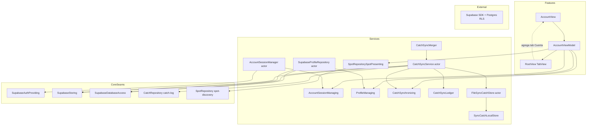
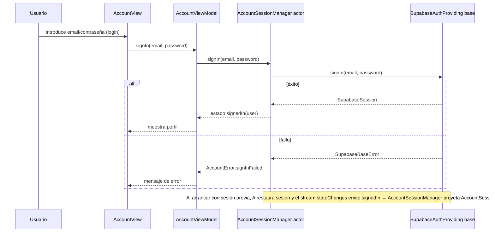
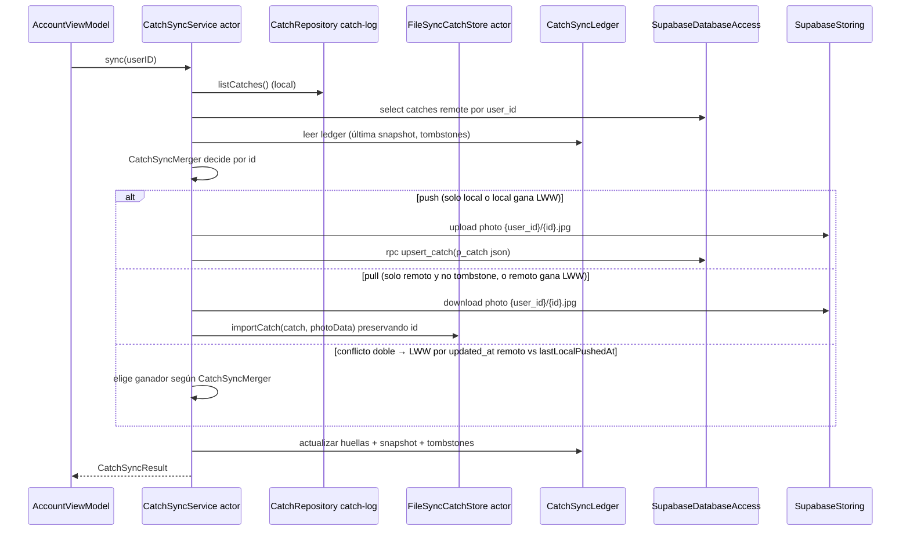

# Design Document: account-personal

---
**Purpose**: Proporcionar suficiente detalle para una implementación consistente y sin deriva de interpretación de la cuenta personal, el perfil, los favoritos y la sincronización del registro de capturas sobre Supabase.
**Enfoque**: Secciones esenciales que informan decisiones de implementación; diagramas y tablas sobre prosa extensa.
---

## Overview

Hoy el registro de capturas vive solo en local (`CatchRepository`/`LocalFileCatchRepository` validado en catch-log) y la app no tiene noción del usuario; los favoritos de spots y el perfil aún no existen. Esta feature entrega la cuenta personal sobre `supabase-foundation`: registro/inicio/cierre de sesión con sesión persistente, perfil con nombre y avatar (storage), favoritos de spots asociados a la cuenta (consumiendo el seam `SpotRepository` de spot-discovery) visibles en el mapa, y sincronización del registro de capturas (push local→Supabase y pull Supabase→local con merge idempotente por `Catch.id`), preservando `CatchRepository` como fuente de verdad local (la sync es una ruta adicional, no un reemplazo).

**Users**: Pescadores que quieren conservar su historial, sus spots favoritos y su perfil entre dispositivos, con o sin reemplazo del móvil.

**Impact**: Añade la primera capa autenticada de la app, el primer esquema remoto propio (perfil, cats remotos) sobre la capa base de Supabase, y la complejidad de un servicio de sincronización dirigido por el registro local. No modifica ningún seam existente de `catch-log`, `fish-species-identification` ni `supabase-foundation`.

### Goals
- Auth funcional de cuenta (signUp/signIn/signOut), sesión persistente/restaurada y estado de sesión observable por la UI.
- Perfil con nombre editable y avatar subido a storage, recuperable tras reinstalar.
- Favoritos de spots por cuenta, gestionados vía el seam `SpotRepository` de spot-discovery (que posee la persistencia), sin depender de la geometría de los spots, expuestos al mapa como conjunto de IDs.
- Sincronización del registro: push de capturas locales hacia la cuenta, pull de la cuenta al registro local y merge idempotente por `Catch.id` con la variante más reciente.
- Acceso a la cuenta desde la navegación principal (nuevo tab "Cuenta").

### Non-Goals
- Cuenta de pago, moderación/rating de spots, subida de spots por usuarios.
- Datos regulatorios por especie.
- Sincronización en tiempo real del mapa.
- Borrado remoto propagado (las capturas borradas localmente no se borran en la cuenta; se marcan para no re-descargarlas).
- Cambiar los contratos de `CatchRepository`, `CatchSaving`, `SupabaseAuthProviding`, `SupabaseStoring`, `SupabaseDatabaseAccess` ni `SpotRepository` de spot-discovery.

## Boundary Commitments

### This Spec Owns
- Los seams `AccountSessionManaging`, `ProfileManaging`, `FavoritesPresenting` y `CatchSynchronizing` con sus implementaciones, el adaptador anti-corrupción `SpotRepositorySpotPresenting` y `SyncCatchLocalStore`.
- El esquema remoto `profiles` y `catches` (más RPC y políticas RLS) y el bucket/objeto de avatares (`avatars/{user_id}/avatar.jpg`).
- El ledger de sincronización (`CatchSyncLedger`, persistido en local) y la lógica de merge/conflicto por `Catch.id`.
- La UI de cuenta (`AccountView`, `AccountViewModel`, formulario de sesión, edición de perfil y lista de favoritos) y su integración en la navegación principal.
- La decisión de que la sync es bidireccional y dirigida por el registro local: las capturas de la cuenta se integran en `Application Support/Catches/` (mismo layout que catch-log), preservando `CatchRepository` como fuente local.

### Out of Boundary
- El mapa y el dominio de favoritos de spots (feature `spot-discovery`): spot-discovery posee el protocolo `SpotRepository`, la tabla `spot_favorites` y las RPC de favoritos; account-personal solo los consume (vía `SpotRepositorySpotPresenting`) para mostrarlos en la cuenta, sin dibujar UI de mapa.
- El esquema de las tablas `spots` y `spot_favorites` (las define spot-discovery) junto con sus RPC y RLS.
- Cambios en `LocalFileCatchRepository` o en los protocolos de catch-log.
- Cambios en los seams base de `supabase-foundation`.
- Borrado remoto de capturas; moderación/rating; pago; sincronización en tiempo real.

### Allowed Dependencies
- `supabase-foundation`: `SupabaseAuthProviding` (+ `SupabaseUser`/`SupabaseAuthEvent`), `SupabaseStoring`, `SupabaseDatabaseAccess` (select/rpc con `SupabaseRPCArguments`/`SupabaseJSONValue`), `SupabaseBaseFake` del test target.
- `catch-log`: `CatchRepository` (lectura local), modelo `Catch`, `Species`, `LocationCoordinate2D`. No se modifica ningún fichero de catch-log.
- `spot-discovery`: `SpotRepository` consumido solo vía el adaptador `SpotRepositorySpotPresenting` en el anti-corruption layer (`favoriteSpotIDs()`/`favoriteSpots()`/`setFavorite(spotID:isFavorite:)`); la cuenta no crea tabla ni RPC propias de favoritos y no se acopla a la geometría.
- Frameworks del sistema: SwiftUI, Foundation, os (Logger), CryptoKit (hash de huellas del ledger).
- El registro local `Application Support/Catches/` con su layout `<uuid>.jpg` + `<uuid>.json` como convención compartida de catch-log, respetándola sin tocar el código de catch-log.

### Revalidation Triggers
- Cambio en el layout de persistencia de catch-log (ruta, nombres, formato de `Catch` en JSON) → rompe `FileSyncCatchStore` y el `CatchSyncMerger`.
- Cambio en el contrato consumido de `SpotRepository` de spot-discovery (`favoriteSpotIDs()`, `favoriteSpots()`, `setFavorite(spotID:isFavorite:)`, tipos de presentación) → rompe `SpotRepositorySpotPresenting`.
- Cambio en longitud/firma de los seams base de `supabase-foundation` (select, rpc, auth, storage).
- Cambio en el modelo `Catch` (campos, tipado) o en `SupabaseUser`.
- Decisión futura de propagar borrados al remoto o de sincronizar el mapa en tiempo real → requiere ampliar este diseño.

## Architecture

### Existing Architecture Analysis
- La app usa MVVM por feature (`@Observable`), services tras protocolos, composition root único (`AppComposition.makeRootServices`), modelos `Codable` en `/Models` y `TabView` en `RootView` (Identificar | Capturas).
- `supabase-foundation` (spec base, pendiente de implementar) definirá `SupabaseStack` (auth/storage/database) construido en el composition root y un `SupabaseBaseFake` para tests; sin configuración de Supabase el stack será nil y esta feature degradará (sección Cuenta "no disponible").
- catch-log valida el layout local de capturas; su seam `CatchRepository` se conserva intacto.

### Architecture Pattern & Boundary Map

MVVM por feature estricto con anti-corruption hacia spot-discovery: la cuenta no conoce geometría; `SpotRepositorySpotPresenting` traduce sólo id/nombre/categoría. La sync vive en `Services/CatchLog` (su propio dominio) y consume el seam `CatchRepository` como lectura, más su propio store local de escritura paralela.



**Architecture Integration**:
- **Selected pattern**: services tras protocolos con anti-corruption hacia la geometría de spots; sync como capa de servicio sobre el seam `CatchRepository` (lectura) + store local paralelo (escritura de pull con id preservado).
- **Domain/feature boundaries**: `Services/Account/` (sesión, perfil, favoritos), `Services/CatchLog/` (sync del registro + ledger + store local), `Features/Account/` (UI). No hay dependencia de Features → Features.
- **Existing patterns preserved**: composition root único, modelos `Codable` en `/Models`, `@Observable` ViewModels, testeo con doubles, Logger.
- **New components rationale**: `CatchSyncLedger` (estado de sync idempotente y LWW), `FileSyncCatchStore` (escritura local que preserva `Catch.id` sin tocar catch-log), `SpotRepositorySpotPresenting` (anti-corruption de favoritos).

### Technology Stack

| Layer | Choice / Version | Role in Feature | Notes |
|-------|------------------|-----------------|-------|
| Frontend | SwiftUI, iOS 17+ | Cuenta, perfil, favoritos, control de sync | `@Observable`; nuevo tab en `TabView` |
| Auth | Supabase Auth vía `SupabaseAuthProviding` | signUp/signIn/signOut/sesión | Son los base; envuelta por `AccountSessionManager` |
| Storage | Supabase Storage vía `SupabaseStoring` | Avatar y fotos de capturas | Buckets `avatars` y `catches` |
| Database | Postgres + PostgREST vía `SupabaseDatabaseAccess` | `profiles`, `catches`; RPC (los favoritos usan `spot_favorites`/RPC de spot-discovery) | Escrituras solo por `rpc` (el seam no tiene insert/update) |
| Sync state | JSON en `Application Support/CatchSync/` | Ledger de sync y tombstones | `FileManager` |
| Runtime | Swift 6, XCTest | Restricciones del proyecto | Actores `Sendable` |

## File Structure Plan

### New Files
```
App/
├── Models/Account/
│   ├── AccountProfile.swift            # Perfil del usuario (userID, displayName, avatarPath) Codable
│   ├── FavoriteSpot.swift              # FavoriteSpot (spotID, name, category) sin geometría
│   └── RemoteCatch.swift               # DTO remoto de captura (Supabase `catches`) + mapeo a/desde Catch
├── Services/Account/
│   ├── AccountSessionManaging.swift    # Protocolo `AccountSessionManaging` + `AccountSessionState` + `AccountError`
│   ├── AccountSessionManager.swift     # Actor que envuelve sin SDK `SupabaseAuthProviding`
│   ├── ProfileManaging.swift           # Protocolo `ProfileManaging` + `AccountProfileError`
│   ├── SupabaseProfileRepository.swift # Actor: perfil + avatar sobre `SupabaseDatabaseAccess`/`SupabaseStoring`
│   ├── FavoritesPresenting.swift       # Protocolo `FavoritesPresenting` + `FavoritesError`
│   └── SpotRepositorySpotPresenting.swift # Adaptador anti-corrupción: consume `SpotRepository` de spot-discovery (favoritos sin geometría; sin tabla/RPC propias)
├── Services/CatchLog/
│   ├── CatchSynchronizing.swift        # Protocolo `CatchSynchronizing` + `CatchSyncResult` + `CatchSyncError`
│   ├── CatchSyncService.swift          # Actor: orquesta push + pull + merge con `CatchRepository`/DB/Storage
│   ├── CatchSyncMerger.swift           # Lógica pura de decisión por Catch.id (push/pull/skip) testeable
│   ├── CatchSyncLedger.swift           # Ledger persistido (huellas, fechas, tombstones) `Codable`
│   ├── SyncCatchLocalStore.swift       # Protocolo `SyncCatchLocalStore` (escritura local de pull)
│   └── FileSyncCatchStore.swift        # Actor: escribe `<id>.json`+`<id>.jpg` en Application Support/Catches/
├── Features/Account/
│   ├── AccountView.swift               # Pantalla de cuenta (no sesión → formulario; sesión → perfil+favoritos+sync)
│   ├── AccountViewModel.swift          # @Observable: auth + perfil + favoritos + sync
│   ├── SignInSignUpFormView.swift      # Formulario email/contraseña con modo registro/login
│   ├── ProfileEditView.swift           # Edición de nombre + selección/subida de avatar
│   └── FavoritesListView.swift         # Lista de favoritos (presentación, sin geometría)
```
SQL de aprovisionamiento (artefacto de infraestructura, no se ejecuta en la app):
```
Supabase/schema/account_personal.sql   # DDL de profiles/catches + RPC + políticas RLS + bucket avatars (favoritos: se consumen de spot-discovery)
```

### Modified Files
```
App/
├── BetterFishingApp.swift             # RootView: añadir tab "Cuenta" (services.accountViewModel)
├── AppCompositionSupport.swift        # Construir AccountViewModel y sus deps cuando supabase != nil; añadir accountViewModel a AppRootServices; wiring de SpotRepositorySpotPresenting
└── BetterFishing.xcodeproj/project.pbxproj  # Registrar los ficheros nuevos en el target (patrón existente)

BetterFishingTests/                   # Fakes y tests nuevos (lista en Testing Strategy)
```

## System Flows

### Inicio de sesión y restauración


### Sync del registro (push + pull + merge)


### Favorito marcado/desmarcado
```mermaid
sequenceDiagram
    participant V as AccountView/FavoritesListView
    participant VM as AccountViewModel
    participant P as SpotRepositorySpotPresenting
    participant R as SpotRepository (spot-discovery)
    V->>VM: toggleFavorite(spot)
    VM->>P: setFavorite(spotID:isFavorite:)
    P->>R: setFavorite(spotID:isFavorite:)
    R-->>P: ok (spot_favorites en spot-discovery)
    P->>R: favoriteSpotIDs()
    R-->>P: Set<UUID>
    P-->>VM: lista actualizada
    VM-->>V: estado de favorito reflejado
    Note over VM: los favoritos son propiedad de spot-discovery; account-personal solo los consume y sincroniza con la cuenta
```

## Requirements Traceability

| Requirement | Summary | Components | Interfaces | Flows |
|-------------|---------|------------|------------|-------|
| 1.1 | Registro crea cuenta y sesión | AccountSessionManager, AccountViewModel, AccountView | Service | Login |
| 1.2 | Inicio de sesión establece sesión | AccountSessionManager | Service | Login |
| 1.3 | Credenciales incorrectas informadas | AccountError, AccountSessionManager | Service | Login |
| 1.4 | Registro fallido distingue motivo | AccountError, AccountSessionManager | Service | Login |
| 1.5 | Estado de carga y sin envíos duplicados | AccountViewModel, AccountView | State | Login |
| 1.6 | Sesión activa reflejada en UI | AccountViewModel, AccountView | State | Login |
| 2.1 | Sesión restaurada al arrancar | AccountSessionManager sobre stateChanges/currentSession base | Service, Event | Auth |
| 2.2 | Usuario y estado autenticado expuestos | AccountSessionState, AccountSessionManager | Service | — |
| 2.3 | Renovación por token de refresco | SupabaseAuthProviding (base), sesión del SDK | Service | — |
| 2.4 | Cierre de sesión termina sesión local | AccountSessionManager, SupabaseAuthProviding | Service | Auth |
| 2.5 | Sesión cambiada notificada y expuesta | AsyncStream<AccountSessionState> | Event | — |
| 2.6 | Fallo de cierre informado y sesión conservada | AccountError, AccountSessionManager | Service | Auth |
| 3.1 | Perfil expuesto con sesión activa | SupabaseProfileRepository, AccountProfile | Service | Perfil |
| 3.2 | Nombre guardado y expuesto actualizado | ProfileManaging, SupabaseProfileRepository (rpc upsert_profile) | Service | Perfil |
| 3.3 | Avatar subido y expuesto | SupabaseProfileRepository (upload avatars bucket) | Service | Perfil, Avatar |
| 3.4 | Perfil recuperado en cualquier dispositivo | SupabaseProfileRepository (select/rpc + download avatar) | Service | Perfil |
| 3.5 | Sin nombre/avatar → por defecto | AccountViewModel, AccountView | State | Perfil |
| 3.6 | Fallo conserva valor anterior | AccountProfileError, AccountViewModel | Service, State | Perfil |
| 4.1 | Permitir marcar favorito con sesión | AccountViewModel, FavoritesListView | State | Favoritos |
| 4.2 | Favorito persistido y expuesto | SpotRepositorySpotPresenting, SpotRepository.setFavorite(spotID:isFavorite:) | Service | Favoritos |
| 4.3 | Desmarcar elimina favorito | SpotRepositorySpotPresenting, SpotRepository.setFavorite(spotID:isFavorite: false) | Service | Favoritos |
| 4.4 | Mapa destaca favoritos | `SpotRepository.favoriteSpotIDs()` (de spot-discovery, ya consumido por el mapa) | Service, Event | Favoritos |
| 4.5 | Favoritos recuperados tras reinstall | SpotRepositorySpotPresenting → `SpotRepository.favoriteSpotIDs()`/`favoriteSpots()` | Service | Favoritos |
| 4.6 | Sin sesión no ofrece favoritos | AccountViewModel, AccountView | State | Favoritos |
| 4.7 | Fallo conserva estado previo | FavoritesError, AccountViewModel | Service, State | Favoritos |
| 4.8 | Favoritos sin depender de geometría | FavoriteSpot, SpotRepositorySpotPresenting | Service | Favoritos |
| 5.1 | Push de capturas locales | CatchSyncService, CatchSyncMerger, rpc upsert_catch | Service, Batch | Sync |
| 5.2 | Pull de capturas de la cuenta | CatchSyncService, FileSyncCatchStore, select | Service, Batch | Sync |
| 5.3 | Merge idempotente por Catch.id | CatchSyncMerger, CatchSyncLedger | Service | Sync |
| 5.4 | Variante más reciente en conflicto | CatchSyncMerger (LWW updated_at vs lastLocalPushedAt) | Service | Sync |
| 5.5 | Fallo conserva registro local y reintento | CatchSyncError, CatchSyncService (ledger solo tras éxito) | Service, State | Sync |
| 5.6 | Registro local como fuente de verdad | Sincronización como ruta adicional sobre CatchRepository | Service | — |
| 5.7 | Borrado local no se re-descarga | CatchSyncLedger.tombstones, CatchSyncMerger | Service | Sync |
| 5.8 | Tras sync, cuenta refleja locales y local refleja no borrados | CatchSyncService push+pull | Batch | Sync |
| 6.1 | Acceso por la navegación principal | RootView tab Cuenta | State | Navegación |
| 6.2 | Vista de cuenta invita a registrarse/login | AccountView (estado signedOut) | State | Navegación |
| 6.3 | Vista con sesión muestra perfil/favoritos/sync | AccountView (estado signedIn) | State | Navegación |
| 6.4 | Sincronizar desde la vista expone resultado | AccountViewModel, CatchSyncResult | Service, State | Navegación |
| 6.5 | Cerrar sesión vuelve a pantalla de sesión | AccountViewModel, AccountView | Service, State | Navegación |

## Components and Interfaces

| Component | Domain/Layer | Intent | Req Coverage | Key Dependencies (P0/P1) | Contracts |
|-----------|--------------|--------|--------------|--------------------------|-----------|
| AccountSessionManager | Service | Envuelve auth base sin SDK; estado de sesión observable | 1, 2 | SupabaseAuthProviding (P0) | Service, Event |
| SupabaseProfileRepository | Service | Perfil + avatar sobre DB/Storage | 3 | SupabaseDatabaseAccess (P0), SupabaseStoring (P0) | Service |
| SpotRepositorySpotPresenting | Service | Consume favoritos de spot-discovery vía `SpotRepository` (anti-corrupción, sin geometría) | 4 | SpotRepository de spot-discovery (P0) | Service, Event |
| CatchSyncService | Service | Push/pull/merge del registro con la cuenta | 5 | CatchRepository (P0), SyncCatchLocalStore (P0), CatchSyncLedger (P0), SupabaseDatabaseAccess (P0), SupabaseStoring (P0) | Service, Batch |
| CatchSyncMerger | Service | Decisión pura por Catch.id (push/pull/skip/LWW) | 5.3, 5.4, 5.7 | — (funciones puras) | — |
| CatchSyncLedger | Service | Estado persistido de sync y tombstones | 5.3, 5.5, 5.7 | FileManager (P0) | State |
| FileSyncCatchStore | Service | Escribe capturas de pull preservando id en `Application Support/Catches/` | 5.2, 5.6 | FileManager (P0) | Service |
| AccountViewModel | UI | Orquesta auth, perfil, favoritos y sync para la vista | 1–6 | AccountSessionManaging (P0), ProfileManaging (P0), FavoritesPresenting (P0), CatchSynchronizing (P0) | Service, State |
| AccountView | UI | Pantalla de cuenta con estados signedOut/signedIn | 6, 1, 2, 3 | AccountViewModel | State |
| SignInSignUpFormView | UI | Formulario email/contraseña | 1, 6.2 | AccountViewModel | State |
| ProfileEditView | UI | Nombre + avatar | 3 | AccountViewModel | State |
| FavoritesListView | UI | Lista de favoritos | 4 | AccountViewModel | State |
| AccountProfile | Models | Perfil del usuario (Codable) | 3 | SuperabaSession/User base | State |
| FavoriteSpot | Models | Presentación del favorito sin geometría | 4.8 | — | State |
| RemoteCatch | Models | DTO remoto de captura y mapeo Catch↔RemoteCatch | 5 | Catch, LocationCoordinate2D, Species | State |

### Services Layer — `Services/Account/`

#### AccountSessionManaging / AccountSessionManager
| Field | Detail |
|-------|--------|
| Intent | Exponer a la UI de cuenta auth con estado de sesión observable y errores tipados, sin filtrar tipos del SDK |
| Requirements | 1.1–1.6, 2.1–2.6, 6.2, 6.5 |

**Contracts**: Service [x] / Event [x]

##### Service Interface
```swift
enum AccountSessionState: Sendable, Equatable {
    case signedOut
    case signedIn(SupabaseUser)
}

enum AccountError: Error, Sendable, LocalizedError {
    case signUpFailed(String)
    case signInFailed(String)
    case signOutFailed(String)
    case sessionUnavailable
}

protocol AccountSessionManaging: Sendable {
    var currentUser: SupabaseUser? { get async }
    var sessionState: AsyncStream<AccountSessionState> { get }
    func signUp(email: String, password: String) async throws
    func signIn(email: String, password: String) async throws
    func signOut() async throws
}
```
- Precondiciones: credenciales no vacías (validación en la vista).
- Postcondiciones: `signUp`/`signIn` dejan `currentUser` no nil y emiten `signedIn`; `signOut` emite `signedOut` y deja `currentUser` nil; errores mapeados desde `SupabaseBaseError` con motivo distinto (créditos inválidos, red, configuración).
- `sessionState` es una proyección de `SupabaseAuthEvent` (signedIn/sessionRestored → `.signedIn`, signedOut → `.signedOut`). La restauración de sesión y su renovación por refresh token se delegan en la capa base/sesión del SDK (Req 2.1, 2.3).

#### ProfileManaging / SupabaseProfileRepository
| Field | Detail |
|-------|--------|
| Intent | Leer/actualizar el perfil (nombre) y gestionar el avatar en storage |
| Requirements | 3.1–3.6 |

**Contracts**: Service [x]

##### Service Interface
```swift
struct AccountProfile: Codable, Sendable, Equatable {
    let userID: UUID
    let displayName: String?
    let avatarPath: String?
}

enum AccountProfileError: Error, Sendable {
    case loadFailed(String)
    case updateFailed(String)
    case uploadAvatarFailed(String)
    case notAuthenticated
}

protocol ProfileManaging: Sendable {
    func profile() async throws -> AccountProfile
    func updateDisplayName(_ name: String) async throws
    func updateAvatar(data: Data, contentType: String) async throws -> String
    func avatarData(avatarPath: String) async throws -> Data?
}
```
- `profile()`: `select` sobre `profiles` filtrando `user_id`; si no existe la fila, se crea por defecto (nombre vacío, sin avatar) → Req 3.5.
- `updateDisplayName`: `rpc upsert_profile` con el `user_id` actual como `p_user_id`.
- `updateAvatar`: `upload` al bucket `avatars`, objeto `{user_id}/avatar.jpg` (upsert: true), devuelve la ruta almacenada; `avatarData` hace `download` por esa ruta.
- Errores tipados por fase (load, update, upload/download, no-auth).

#### SpotRepositorySpotPresenting (consumo de favoritos de spot-discovery)
| Field | Detail |
|-------|--------|
| Intent | Presentar y sincronizar los favoritos de la cuenta consumiendo el protocolo `SpotRepository` de spot-discovery, sin duplicar tabla/RPC propias y sin tocar la geometría |
| Requirements | 4.1–4.8 |

**Contracts**: Service [x] / Event [x]

La cuenta **no define** favoritos propios: la tabla `spot_favorites`, las RPC `my_favorite_*`/`add_spot_favorite`/`remove_spot_favorite` y el protocolo `SpotRepository` son propiedad de spot-discovery. account-personal los consume (el adaptador `SpotRepositorySpotPresenting` se inyecta desde el composition root con el `SpotRepository` de spot-discovery) y mantiene `FavoriteSpot` como proyección de presentación sin geometría.

##### Service Interface
```swift
struct FavoriteSpot: Codable, Sendable, Equatable, Identifiable {
    let spotID: UUID
    let name: String
    let category: String?
    var id: UUID { spotID }
}

enum FavoritesError: Error, Sendable {
    case loadFailed(String)
    case saveFailed(String)
    case removeFailed(String)
    case notAuthenticated
    case authenticationRequired
}

protocol FavoritesPresenting: Sendable {
    func favorites() async throws -> [FavoriteSpot]
    func favoriteSpotIDs() async throws -> Set<UUID>
    func isFavorite(spotID: UUID) async throws -> Bool
    func setFavorite(spotID: UUID, isFavorite: Bool) async throws
}
```
- `favorites()`: `SpotRepository.favoriteSpots()` → mapea `[Spot]` a `[FavoriteSpot]` (solo id/name/category). Los IDs sin información de presentación se omiten de la lista pero se conservan en `favoriteSpotIDs()`.
- `favoriteSpotIDs()`: delega en `SpotRepository.favoriteSpotIDs()` (conjunto de `spot_id` de la cuenta); es el seam que el mapa de spot-discovery ya consume (Req 4.4).
- `setFavorite(spotID:isFavorite:)`: delega en `SpotRepository.setFavorite(spotID:isFavorite:)`; el gate de sesión (`authenticationRequired`) lo impone spot-discovery (Reqs 4.1, 4.6).
- El adaptador recibe `SpotRepository` del composition root; no define ninguna tabla, RPC ni seam propio de favoritos (la persistencia y sus RPC viven en spot-discovery).

##### Adaptador anti-corrupción hacia spot-discovery
```swift
struct SpotRepositorySpotPresenting: FavoritesPresenting {
    private let repository: any SpotRepository   // de spot-discovery
    func favoriteSpotIDs() async throws -> Set<UUID> { try await repository.favoriteSpotIDs() }
    func favorites() async throws -> [FavoriteSpot] {
        try await repository.favoriteSpots().map { FavoriteSpot(spotID: $0.id, name: $0.name, category: $0.category) }
    }
    func isFavorite(spotID: UUID) async throws -> Bool {
        try await favoriteSpotIDs().contains(spotID)
    }
    func setFavorite(spotID: UUID, isFavorite: Bool) async throws {
        try await repository.setFavorite(spotID: spotID, isFavorite: isFavorite)
    }
}
```
- El adaptador solo extrae `id`, `name` y `category`; ningún campo geométrico entra en el boundary de la cuenta. El contrato consumido de `SpotRepository` es `favoriteSpotIDs()`/`favoriteSpots()`/`setFavorite(spotID:isFavorite:)` (y `spot(id:)` si se necesita hidratar la presentación) — Revalidation Trigger.

### Services Layer — `Services/CatchLog/`

#### CatchSynchronizing / CatchSyncService
| Field | Detail |
|-------|--------|
| Intent | Sincronizar el registro local con la cuenta de forma bidireccional, idempotente y dirigida por el registro local |
| Requirements | 5.1–5.8, 6.4 |

**Contracts**: Service [x] / Batch [x]

##### Service Interface
```swift
struct CatchSyncResult: Sendable, Equatable {
    let pushed: Int
    let pulled: Int
    let skipped: Int
}

enum CatchSyncError: Error, Sendable {
    case noSession
    case remoteLoadFailed(String)
    case pushFailed(String)
    case pullFailed(String)
    case ledgerFailed(String)
}

protocol CatchSynchronizing: Sendable {
    func sync(userID: UUID) async throws -> CatchSyncResult
}
```
- `sync(userID:)` ejecuta la secuencia: (1) leer locales vía `CatchRepository.listCatches()`; (2) leer remotos vía `select` sobre `catches` con `user_id`; (3) cargar estado del `CatchSyncLedger`; (4) decidir acción por id con `CatchSyncMerger`; (5) ejecutar push/pull; (6) persistir el ledger solo si el paso completo tiene éxito (Reqs 5.5, 5.6).
- Push: para cada id local no presente en remoto (o ganador LWW), `rpc upsert_catch` con el `Catch` serializado a JSON + `upload` de la foto a `catches/{user_id}/{id}.jpg`.
- Pull: para cada id remoto ausente en local y no tombstoned, `download` de la foto y `FileSyncCatchStore.importCatch(catch:, photoData:)` preservando el `Catch.id` remoto (Req 5.2).
- Tombstones: los ids presentes en `lastSyncedRemoteIDs` del ledger pero ausentes del registro local se registran como tombstone y no se vuelven a descargar (Req 5.7).

#### CatchSyncMerger
| Field | Detail |
|-------|--------|
| Intent | Decidir por `Catch.id` si un catch se empuja, tira o se omite, sin efectos secundarios |
| Requirements | 5.3, 5.4, 5.7 |

**Contracts**: Service [x]

##### Service Interface
```swift
enum CatchSyncAction: Sendable, Equatable {
    case push(Catch)          // local → remoto
    case pull(RemoteCatch)    // remoto → local
    case skip
}

struct CatchSyncMergerInput: Sendable {
    let local: Catch?
    let remote: RemoteCatch?
    let localFingerprint: Fingerprint?
    let ledger: CatchSyncLedgerSnapshot
    let now: Date
}

struct CatchSyncMerger {
    static func decide(for id: UUID, input: CatchSyncMergerInput) -> CatchSyncAction
}
```
- Reglas (documentadas y OUI de unidad):
  1. `local == nil && remote == nil` → `.skip`.
  2. `remote == nil && local != nil` → `.push(local)`.
  3. `local == nil && remote != nil`: si el id está tombstoned → `.skip`; si no → `.pull`.
  4. Ambos existen:
     - `remoteChanged = remote.updated_at != ledger.lastRemoteUpdatedAt`
     - `localChanged = localFingerprint != ledger.lastLocalFingerprint`
     - `!remoteChanged && !localChanged` → `.skip` (idempotencia).
     - `!localChanged && remoteChanged` → `.pull(remote)`.
     - `localChanged && !remoteChanged` → `.push(local)`.
     - Ambos cambiados → LWW: si `remote.updated_at > ledger.lastLocalPushedAt` → `.pull`; si no → `.push`. Empate exacto → `.push` (la fuente local manda, Req 5.6).
- `Fingerprint` = hash (CryptoKit) de la serialización canónica de `Catch` (id, species, date, location, notes) usada para detectar cambios locales.

#### CatchSyncLedger
| Field | Detail |
|-------|--------|
| Intent | Persistir el estado de sync para idempotencia y LWW |
| Requirements | 5.3, 5.5, 5.7 |

**Contracts**: State [x]

##### State / Structure
```swift
enum Fingerprint: Codable, Sendable, Equatable { case sha256(String) }

struct CatchSyncLedgerSnapshot: Codable, Sendable, Equatable {
    var entries: [UUID: CatchSyncLedgerEntry]  // por Catch.id
    var tombstonedIDs: Set<UUID>
    var lastSyncedRemoteIDs: Set<UUID>
}
struct CatchSyncLedgerEntry: Codable, Sendable, Equatable {
    var lastLocalFingerprint: Fingerprint?
    var lastRemoteUpdatedAt: Date?
    var lastLocalPushedAt: Date?
}

actor CatchSyncLedger {
    func snapshot() async throws -> CatchSyncLedgerSnapshot
    func commit(_ snapshot: CatchSyncLedgerSnapshot) async throws
}
```
- Fichero: `Application Support/CatchSync/sync-ledger.json` (escribto atómico).
- Precondición: los commits son completos al final de cada sync exitosa (los fallos no actualizan el ledger → reintento seguro, Req 5.5).
- `tombstonedIDs`: depende de la diferencia entre `lastSyncedRemoteIDs` y el registro local actual al sync (Req 5.7).

#### SyncCatchLocalStore / FileSyncCatchStore
| Field | Detail |
|-------|--------|
| Intent | Escritura local de las capturas de la pull preservando `Catch.id`, respetando el layout de catch-log sin tocar su código |
| Requirements | 5.2, 5.6 |

**Contracts**: Service [x]

##### Service Interface
```swift
protocol SyncCatchLocalStore: Sendable {
    func importCatch(_ entry: Catch, photoData: Data?) async throws
    func localCatch(id: UUID) async throws -> Catch?
    func localModificationDate(id: UUID) async throws -> Date?
    func photoData(for id: UUID) async -> Data?
}
```
- `importCatch`: escribe `<id>.json` (metadatos `Catch` con el `id` dado) y, si `photoData != nil`, `<id>.jpg`, en `Application Support/Catches/` (el mismo directorio que usa `LocalFileCatchRepository`). Si la foto falta, la captura queda sin thumbnail (la UI de catch-log ya maneja `nil`).
- Invariante: la escritura es atómica (JSON primero, luego foto; o marcador temporal) y nunca pisa un `.json` de otra id.
- `FileSyncCatchStore` obtiene el directorio de persistencia desde el composition root (misma URL que `LocalFileCatchRepository`); el layout compartido es un Revalidation Trigger.

### UI Layer — `Features/Account/`

#### AccountViewModel
| Field | Detail |
|-------|--------|
| Intent | Orquesta sesión, perfil, favoritos y sync para `AccountView` |
| Requirements | 1–6 |

**Implementation Notes**:
- `@MainActor @Observable`. Estados: `sessionState`, `profile`, `favorites`, `isSyncing`, `lastSyncResult`, `errorMessage`.
- Al aparecer: suscribirse a `sessionState`; si `signedIn`, cargar perfil y favoritos; si `signedOut`, limpiar estado de datos personales (Req 2.5).
- Acciones: `signUp`, `signIn`, `signOut`, `saveDisplayName`, `uploadAvatar`, `toggleFavorite`, `sync`.
- El botón de sync expone `CatchSyncResult` o `CatchSyncError` (Req 6.4).

#### AccountView (y subvistas)
- `signedOut`: `SignInSignUpFormView` con pestañas registro/login (Req 6.2, 1.1–1.5).
- `signedIn`: cabecera de perfil (nombre + avatar, `ProfileEditView`), `FavoritesListView`, botón "Sincronizar" y cierre de sesión (Req 6.3, 6.4, 6.5).
- Sin contexto de Supabase (`accountViewModel == nil` en composition root): sección "Cuenta" con estado *no disponible* y explicación (degradación elegante de `supabase-foundation`).

### UI Integration: RootView / TabView
- Añadir tercer tab "Cuenta" (`person.crop.circle`) con `AccountView`. El patrón `TabView` ya existe en `BetterFishingApp.swift:59` y conserva el estado por tab.

## Data Models

### Domain Model
- `Catch` (catch-log): modelo local que se sincroniza; un catch local = una fila remota `catches` con el mismo `id`.
- `FavoriteSpot`: proyección sin geometría (id, name, category) de la fila `spot_favorites` que spot-discovery posee y gestiona.
- `AccountProfile`: usuario en `profiles`.

### Physical Data Model (Supabase, DDL en `Supabase/schema/account_personal.sql`)
```sql
create extension if not exists pgcrypto;

-- Perfiles
create table if not exists public.profiles (
  user_id uuid primary key references auth.users(id) on delete cascade,
  display_name text,
  avatar_path text,
  updated_at timestamptz not null default now()
);

-- Favoritos: NO se definen aquí; la tabla `spot_favorites`, sus índices, RLS y RPC
-- (my_favorite_* / add_spot_favorite / remove_spot_favorite) son propiedad de spot-discovery.

-- Capturas sincronizadas (id = Catch.id)
create table if not exists public.catches (
  id uuid primary key,
  user_id uuid not null references auth.users(id) on delete cascade,
  species jsonb not null,
  date timestamptz not null,
  location jsonb,
  notes text not null default '',
  created_at timestamptz not null,
  updated_at timestamptz not null default now(),
  photo_path text,
  unique (id, user_id)
);
create index if not exists catches_user_id_idx on public.catches (user_id);

-- RLS
alter table public.profiles enable row level security;
alter table public.catches enable row level security;

create policy profiles_own on public.profiles
  for all using (auth.uid() = user_id) with check (auth.uid() = user_id);
create policy catches_own on public.catches
  for all using (auth.uid() = user_id) with check (auth.uid() = user_id);

-- RPCs
create or replace function public.upsert_profile(
  p_user_id uuid, p_display_name text, p_avatar_path text, p_updated_at timestamptz default now()
) returns void
language sql security invoker set search_path = public
as $$
  insert into public.profiles (user_id, display_name, avatar_path, updated_at)
  values (p_user_id, p_display_name, p_avatar_path, p_updated_at)
  on conflict (user_id) do update set
    display_name = excluded.display_name,
    avatar_path = excluded.avatar_path,
    updated_at = excluded.updated_at
  where public.profiles.user_id = auth.uid()
$$;

create or replace function public.upsert_catch(p_user_id uuid, p_catch text)
returns void
language plpgsql security invoker set search_path = public
as $$
declare c jsonb := p_catch::jsonb;
begin
  insert into public.catches (id, user_id, species, date, location, notes, created_at, photo_path)
  values (
    (c ->> 'id')::uuid,
    p_user_id,
    c -> 'species',
    (c ->> 'date')::timestamptz,
    c -> 'location',
    coalesce(c ->> 'notes', ''),
    (c ->> 'createdAt')::timestamptz,
    c ->> 'photoPath'
  )
  on conflict (id) do update set
    species = excluded.species,
    date = excluded.date,
    location = excluded.location,
    notes = excluded.notes,
    photo_path = excluded.photo_path,
    updated_at = now()
  where public.catches.user_id = auth.uid();
end $$;
```
> Notas: `auth.uid()` como guard en upserts para garantizar que solo el dueño modifica sus filas (defensa en profundidad además del `where`). `upsert_catch` usa `security invoker` + RLS. Los favoritos de spots **no** se definen aquí: son propiedad de spot-discovery (`spot_favorites` + RPC `my_favorite_*`/`add_spot_favorite`/`remove_spot_favorite`); account-personal los consume vía `SpotRepository`. El bucket `avatars` se crea por provisioning (Supabase dashboard/CLI) junto con políticas de acceso por `user_id`; el bucket `catches` idéntico para fotos de capturas.

### RemoteCatch (DTO y mapeo)
```swift
struct RemoteCatch: Codable, Sendable, Equatable, Identifiable {
    let id: UUID
    let userID: UUID
    let species: Species
    let date: Date
    let location: LocationCoordinate2D?
    let notes: String
    let createdAt: Date
    let updatedAt: Date
    let photoPath: String?

    enum CodingKeys: String, CodingKey {
        case id, species, date, location, notes, photoPath = "photo_path"
        case userID = "user_id", createdAt = "created_at", updatedAt = "updated_at"
    }

    func asCatch() async throws -> Catch  // mapeo a modelo local conservando id
}
```
- Los campos `species`/`location` se almacenan como `jsonb`, lo que permite decodificarlos directamente `Species`/`LocationCoordinate2D` (ambos `Codable`).
- La foto remota vive en `catches/{user_id}/{id}.jpg`; `photoPath` guarda la ruta relativa al bucket para la visualización/descarga.

## Error Handling

### Error Strategy
- **Fail fast**: validar credenciales y nombre antes de llamar a los servicios; sync sin sesión → `CatchSyncError.noSession`.
- **Graceful degradation**: sin sesión la UI de cuenta muestra login; sin contexto de Supabase la sección de cuenta muestra "no disponible" sin romper el arranque (alineado con foundation).
- **User context**: mensajes accionables y localizables por causa (`AccountError`, `AccountProfileError`, `FavoritesError`, `CatchSyncError`).

### Error Categories and Responses
**Auth (Req 1.3, 1.4, 2.6)**:
- Credenciales inválidas → `AccountError.signInFailed`; email en uso/contraseña débil → `AccountError.signUpFailed` (motivo del SDK); red/configuración → mensaje equivalente.
- Fallo de cierre → `AccountError.signOutFailed`, se conserva la sesión.

**Perfil (Req 3.6)**:
- Nombre/avatar fallo → `AccountProfileError.updateFailed/uploadAvatarFailed`; la vista conserva el valor anterior.

**Favoritos (Req 4.7)**:
- Los fallos de `SpotRepository` (`SpotRepositoryError`) se traducen a `FavoritesError` (`saveFailed/removeFailed/loadFailed/authenticationRequired`); el ViewModel re-consulta el estado real y lo muestra; no muta el estado optimista sin confirmación remota.

**Sync (Req 5.5)**:
- `remoteLoadFailed/pushFailed/pullFailed` → no se commitea el ledger; el registro local queda intacto; `CatchSyncResult` no se emite, la UI ofrece reintentar.

### Monitoring
- Logger (os.Logger, categorías `Account`, `CatchSync`) de: eventos de sesión (sin tokens), creación/actualización de perfil, cambios de favorito, y resumen de cada sync (pushed/pulled/skipped + tombstones) sin volcar contenido.

## Testing Strategy

### Unit Tests
- `AccountSessionManagerTests` con `SupabaseBaseFake`: signUp/signIn emiten `signedIn`; signOut emite `signedOut`; fallo de signin → `AccountError.signInFailed`; restauración de sesión (evento sessionRestored → signedIn). (Req 1.x, 2.x)
- `CatchSyncMergerTests`: matriz de decisiones — solo local → push; solo remoto → pull; ambos sin cambios → skip; solo local cambió → push; solo remoto cambió → pull; ambos cambiaron → LWW por `updated_at`/`lastLocalPushedAt`; empate → push; tombstone → pull bloqueado. (Req 5.3, 5.4, 5.7)
- `CatchSyncLedgerTests`: round-trip Codable del snapshot con directorio temporal; commit fallido no altera el snapshot previo. (Req 5.5)
- `RemoteCatchTests`: round-trip Codable incluyendo species/location jsonb; `asCatch()` preserva el id. (Req 5.2)
- `SupabaseProfileRepositoryTests` (con fakes de db/storage): perfil por defecto si no existe; updateName llama upsert_profile; avatar upload devuelve ruta y download la recupera. (Req 3.x)

### Integration Tests
- `CatchSyncServiceTests` con `SupabaseBaseFake` (select/rpc) + `FileSyncCatchStore` + `CatchRepository` reales en directorios temporales: push de 2 capturas locales idempotente (segunda llamada → 0 pushed); pull trae capturas remotas al registro local preservando id; tras borrar localmente una captura sincronizada, siguiente sync no la re-descarga (tombstone); LWW: captura local más reciente gana. (Req 5.1–5.8)
- `FileSyncCatchStoreTests`: importCatch con id fijo es leída por `CatchRepository.listCatches()` (integración cruzada con catch-log); escritura atómica; foto opcional. (Req 5.2, 5.6)
- `SpotRepositorySpotPresentingTests` con un doble de `SpotRepository` de spot-discovery (éxito/fallo programables según el patrón de spot-discovery): `favoriteSpotIDs`/`favorites`/`setFavorite` delegan en el seam y filtran la presentación sin geometría; `authenticationRequired` del seam se traduce a `FavoritesError`. (Req 4.x)

### E2E/UI Tests
- Flujo sesión: sin sesión → formulario; login con doble → perfil visible; logout → vuelve al formulario. (Req 6.2, 6.3, 6.5)
- Flujo perfil: editar nombre → se muestra actualizado; avatar → se muestra. (Req 3.x)
- Flujo favoritos: marcar/desmarcar favorito → lista refleja; `favoriteSpotIDs` expuesto. (Req 4.x)
- Flujo sync: con fakes de datos, pulsar "Sincronizar" → resultado éxito visible (pushed/pulled) y registro local conservado tras fallo simulado. (Req 5.x, 6.4)

## Optional Sections

### Security Considerations
- Todas las tablas nuevas usan RLS `auth.uid()`; las RPC upsert filtran por el `user_id` autenticado para impedir escritura cruzada (defensa en profundidad).
- El cliente usa la anon key publicable; el acceso a datos queda protegido por RLS y por las funciones con `security invoker`.
- Los tokens de sesión no se registran en logs; los criterios de avatar/fotos viven en buckets con acceso RLS a nivel de objeto (provisioning).
- La cuenta expone solo datos del usuario autenticado; sin sesión no se cargan favoritos ni se sincroniza.

### Performance & Scalability
- La sync lista capturas locales y remotas completas; `catches_user_id_idx` acota la lectura remota por usuario. Para registros grandes (<1000) es suficiente; la paginación del `select` remoto y el procesamiento incremental quedan como mejora futura si crece el volumen.
- El ledger se reescribe completo tras cada sync; fichero pequeño (una entrada por id), sin riesgo relevante.

### Migration Strategy
- No hay migración de datos locales en esta feature (catch-log ya migró borradores). El esquema remoto se crea por provisioning (`Supabase/schema/account_personal.sql`) y es idempotente (`create table if not exists`, `or replace function`). La primera sync de una cuenta existente actúa como migración de subida: todas las capturas locales se empujan (o se conservan si el remoto ya las tenía).