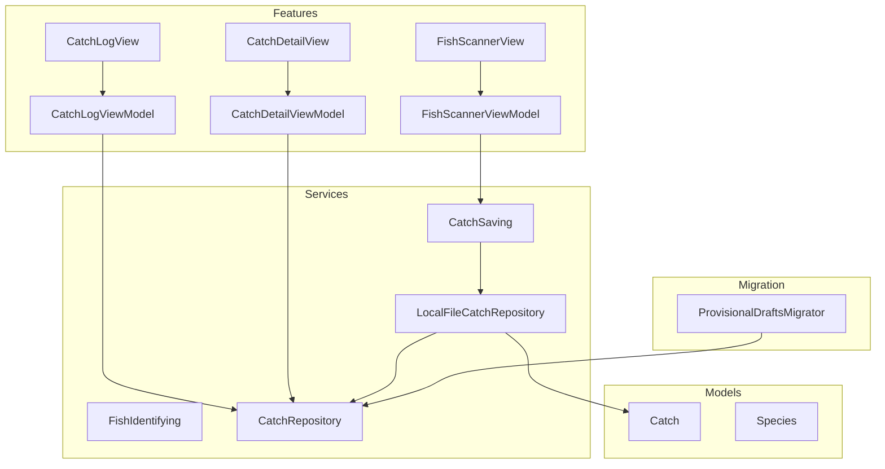
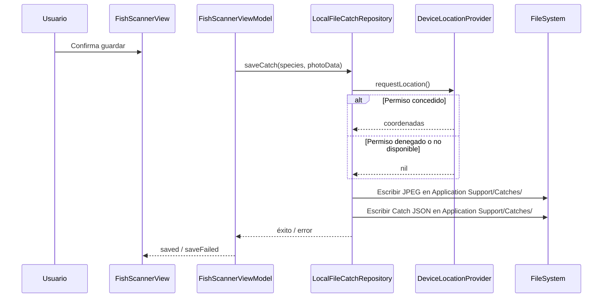
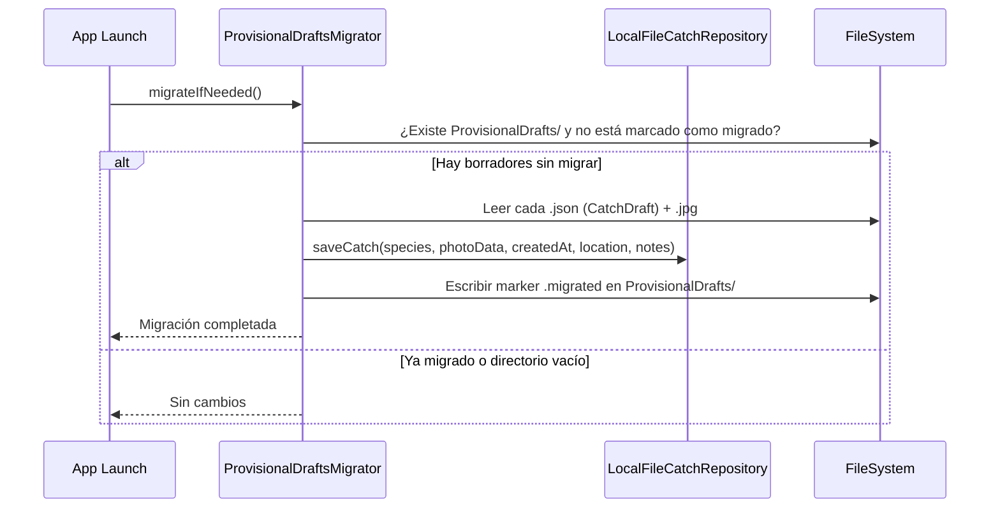
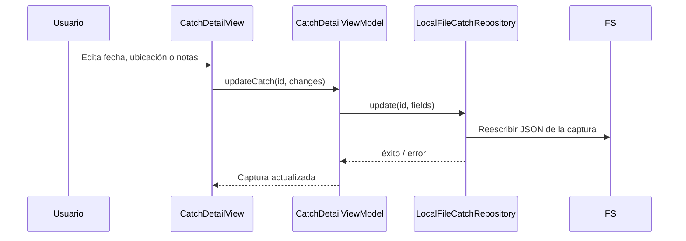
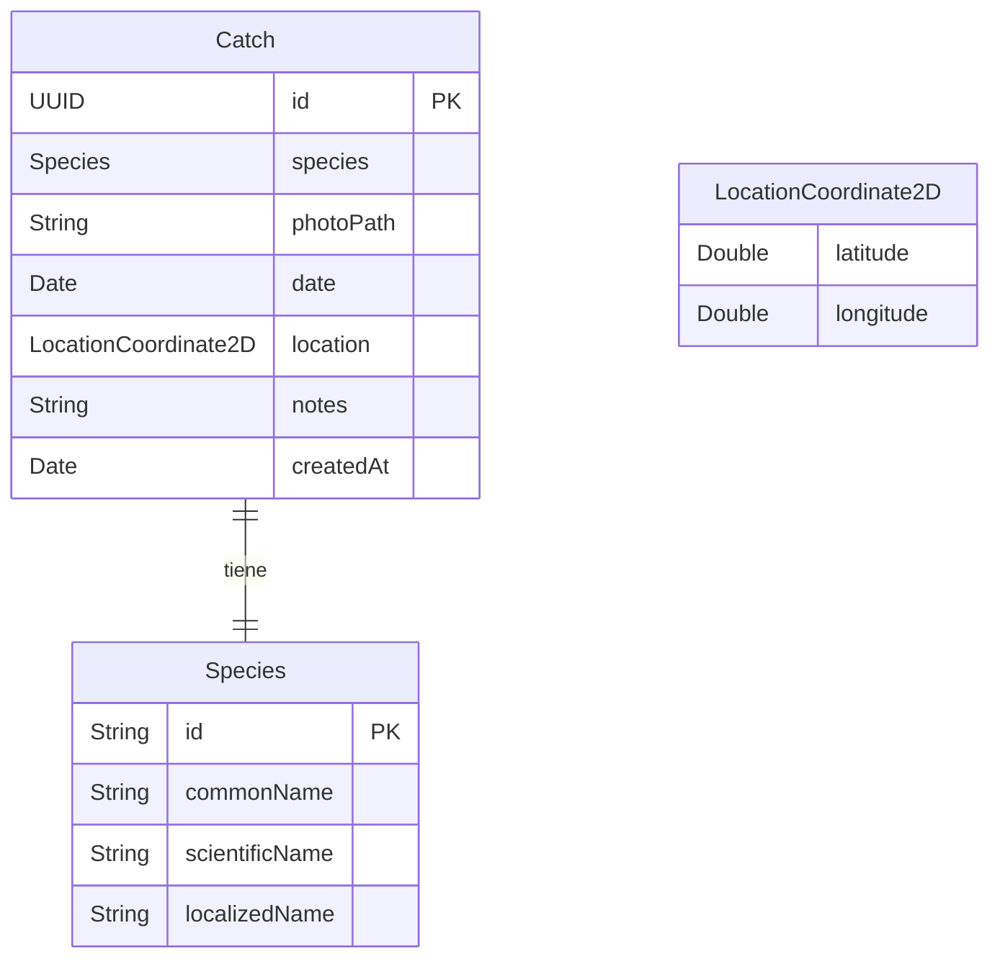

# Design Document: catch-log

---
**Purpose**: Proporcionar suficiente detalle para una implementación consistente y sin deriva de interpretación entre implementadores.
**Enfoque**: Secciones esenciales que informan decisiones de implementación; diagramas y tablas sobre prosa extensa.
---

## Overview

El pescador identifica la especie desde el escáner y quiere llevar un registro personal de sus capturas. Hoy el guardado desde la identificación es un borrador provisional aislado (`LocalDraftCatchSaver` en `Application Support/ProvisionalDrafts/`) sin historial. Esta feature aporta un registro de capturas local con historial: las capturas guardadas desde el escáner pasan directamente a un registro consultable con especie, foto, fecha/hora, ubicación opcional y notas, con soporte para edición, borrado y migración de los borradores existentes. La navegación principal pasa a un `TabView` con Identificar y Capturas.

**Users**: Pescadores que quieren llevar un registro personal de sus capturas a lo largo del tiempo sin perder contexto de especie, fecha, ubicación ni notas.

**Impact**: Sustituye el guardado provisional de la spec `fish-species-identification` y añade la primera pantalla de navegación de la app (registro de capturas). El seam `CatchSaving` pasa a estar implementado por el repositorio real.

### Goals
- Modelo definitivo `Catch` con campos de dominio completos (especie, foto, fecha/hora, ubicación, notas).
- Repositorio local CRUD (`CatchRepository` / `LocalFileCatchRepository`) persistiendo en `Application Support/Catches/`.
- UI de historial (listado ordenado por fecha, detalle, edición de fecha/ubicación/notas, borrado con confirmación).
- Migración única de los borradores de `ProvisionalDrafts/` al primer arranque.
- Navegación por `TabView` con conservación de estado entre tabs.

### Non-Goals
- Sincronización a nube o cuenta de usuario.
- Mapa de spots de pesca.
- Información regulatoria/descriptiva de especies.
- Re-identificar una foto guardada o sustituir la foto de una captura.
- Editar la especie o la foto de una captura existente.

## Boundary Commitments

### This Spec Owns
- Modelo definitivo `Catch` (reemplaza `CatchDraft`).
- Protocolo `CatchRepository` y su implementación `LocalFileCatchRepository` (CRUD local en JSON + JPEG).
- Vista de historial (`CatchLogView`), vista de detalle/edición (`CatchDetailView`) y sus ViewModels.
- Migrador `ProvisionalDraftsMigrator` (convierte borradores en capturas del registro, una única vez).
- Integración del seam `CatchSaving` con el repositorio real (el repositorio ahora implementa `CatchSaving`).
- Navegación `TabView` en `RootView` con las dos features.
- Solicitud de permiso de ubicación al guardar y captura de la ubicación del dispositivo.

### Out of Boundary
- Sincronización a nube y cuenta de usuario.
- Decisión de almacenamiento definitivo en Supabase (el protocolo `CatchRepository` lo permite; la implementación backend es trabajo futuro).
- Datos de especie (normativa, talla mínima, temporada).
- Modificación de la lógica de identificación o del escáner.

### Allowed Dependencies
- `fish-species-identification`: `Species`, seam `CatchSaving`/`FishIdentifying`, imagen comprimida.
- `CoreLocation` para permiso de ubicación y coordenadas actuales al guardar.
- `FileManager` para persistencia basada en archivos.
- Frameworks del sistema: SwiftUI, CoreLocation, os (Logger).
- Sin librerías de terceros nuevas.

### Revalidation Triggers
- Cambio en el contrato del seam `CatchSaving` (nombre de método, tipos de entrada).
- Cambio en el modelo `Species` (campos, tipado).
- Cambio en la dirección de dependencias (si el escáner pasa a depender del registro).
- Cambio en la lógica de guardado desde el escáner (FishScannerViewModel.saveCapturedCatch).

## Architecture

### Architecture Pattern & Boundary Map

MVVM por feature (alineado con `structure.md`): cada feature (Identificar, Capturas) tiene su ViewModel `@Observable`; el ViewModel orquesta los Services; los Services detrás de protocolos; los modelos Codable viven en `/Models`; Core aloja utilidades compartidas. Dependencias: Features → Services → Core → Models.



**Architecture Integration**:
- **Selected pattern**: MVVM por feature con Services tras protocolos (steering).
- **Domain/feature boundaries**: `FishScanner` sigue sin conocer la persistencia; el repositorio real implementa `CatchSaving` y se inyecta en el ViewModel del escáner.
- **Existing patterns preserved**: feature-first, MVVM, modelos en `/Models`, servicios tras protocolos.

### Technology Stack

| Layer | Choice / Version | Role in Feature | Notes |
|-------|------------------|-----------------|-------|
| Frontend | SwiftUI, iOS 17+ | Historial, detalle, edición, navegación por tabs | `@Observable` ViewModels; `List`, `NavigationStack` |
| Location | CoreLocation | Permiso de ubicación + coordenadas al guardar | `CLLocationManager` encapsulado |
| Storage | FileManager (JSON + JPEG en Application Support) | Persistencia local del registro | Protocolo reemplazable por backend |
| Navigation | SwiftUI TabView | Acceso a las dos features | Conserva estado por tab |

## File Structure Plan

### New Files
```
App/
├── Models/
│   └── Catch.swift                    # Modelo definitivo de captura + LocationCoordinate2D (reemplaza CatchDraft)
├── Services/CatchLog/
│   ├── CatchRepository.swift          # Protocolo CRUD del registro
│   ├── LocalFileCatchRepository.swift # Implementación local (JSON + JPEG en Application Support/Catches/)
│   └── ProvisionalDraftsMigrator.swift # Migración única de ProvisionalDrafts → Catches
├── Features/CatchLog/
│   ├── CatchLogView.swift             # Listado de capturas ordenado por fecha
│   ├── CatchLogViewModel.swift        # @Observable: carga y gestión del listado
│   ├── CatchDetailView.swift          # Detalle y edición de una captura
│   └── CatchDetailViewModel.swift     # @Observable: edición de fecha, ubicación y notas
└── Core/Location/
    └── DeviceLocationProvider.swift   # Solicitud de permiso y obtención de coordenadas
```

### Modified Files
```
App/
├── BetterFishingApp.swift             # RootView → TabView con Identificar | Capturas
├── AppCompositionSupport.swift        # Composition root: construir repositorio, inyectar como CatchSaving
├── Models/
│   └── CatchDraft.swift               # Deprecado (se conserva para la migración pero se elimina de uso activo)
```

### Files Eliminated (replaced)
- `App/Services/FishID/LocalDraftCatchSaver.swift` — reemplazado por `LocalFileCatchRepository`

## System Flows

### Guardado desde el escáner (integración con CatchSaving)



### Migración de borradores al arranque



### Edición de una captura



## Requirements Traceability

| Requirement | Summary | Components | Interfaces | Flows |
|-------------|---------|------------|------------|-------|
| 1.1 | Guardar desde escáner directamente en el registro | CatchRepository, LocalFileCatchRepository, FishScannerViewModel | Service | Guardado |
| 1.2 | Solicitar permiso de ubicación al guardar | DeviceLocationProvider, LocalFileCatchRepository | Service | Guardado |
| 1.3 | Registrar ubicación si permiso concedido | DeviceLocationProvider, LocalFileCatchRepository | Service | Guardado |
| 1.4 | Guardar sin ubicación si permiso denegado | LocalFileCatchRepository | Service | Guardado |
| 1.5 | Informar fallo de guardado y permitir reintentar | FishScannerViewModel, FishScannerView | State | Guardado |
| 1.6 | Confirmar éxito y permitir volver al inicio | FishScannerView | State | Guardado |
| 1.7 | Mostrar captura guardada en el historial | CatchLogView, CatchLogViewModel | State | Historial |
| 2.1 | Listado ordenado de más reciente a más antigua | CatchLogView, CatchLogViewModel | State | Historial |
| 2.2 | Estado vacío cuando no hay capturas | CatchLogView | State | Historial |
| 2.3 | Persistencia entre sesiones | LocalFileCatchRepository | Service | — |
| 2.4 | Seleccionar captura muestra detalle | CatchDetailView, NavigationStack | State | Historial |
| 2.5 | Edición o adición se refleja en el listado | CatchLogViewModel | State | Historial |
| 3.1 | Mostrar especie, foto, fecha, ubicación y notas | CatchDetailView | State | Detalle |
| 3.2 | Permitir editar fecha, ubicación y notas | CatchDetailViewModel, CatchRepository | State, Service | Edición |
| 3.3 | Impedir modificar especie y foto | CatchDetailView | State | Detalle |
| 3.4 | Guardar cambios en detalle e historial | CatchDetailViewModel, CatchRepository | Service | Edición |
| 3.5 | Cancelar edición descarta cambios | CatchDetailViewModel | State | Edición |
| 4.1 | Pedir confirmación antes de borrar | CatchDetailView | State | Borrado |
| 4.2 | Borrar captura y quitar del historial | CatchDetailViewModel, CatchRepository | Service | Borrado |
| 4.3 | Informar fallo de borrado | CatchDetailView | State | Borrado |
| 5.1 | Migrar borradores existentes una única vez | ProvisionalDraftsMigrator, CatchRepository | Service | Migración |
| 5.2 | Omitir borradores incompletos sin impedir arranque | ProvisionalDraftsMigrator | Service | Migración |
| 5.3 | No re-migrar borradores ya migrados | ProvisionalDraftsMigrator | Service | Migración |
| 6.1 | Acceso al escáner y al historial desde navegación principal | RootView (TabView) | State | Navegación |
| 6.2 | Conservar estado al alternar entre tabs | RootView (TabView) | State | Navegación |

## Components and Interfaces

| Component | Domain/Layer | Intent | Req Coverage | Key Dependencies (P0/P1) | Contracts |
|-----------|--------------|--------|--------------|--------------------------|-----------|
| CatchRepository | Service | Protocolo CRUD del registro de capturas | 1, 2, 3, 4 | — | Service |
| LocalFileCatchRepository | Service | Implementación local: JSON + JPEG en Application Support | 1–5 | FileManager (P0), DeviceLocationProvider (P1) | Service |
| ProvisionalDraftsMigrator | Service | Migración única de ProvisionalDrafts al registro | 5.1–5.3 | CatchRepository (P0), FileManager | Service |
| DeviceLocationProvider | Core | Solicitud de permiso y obtención de coordenadas | 1.2, 1.3 | CoreLocation (P0) | Service |
| CatchLogView | UI | Listado de capturas con navegación a detalle | 2, 6 | CatchLogViewModel | State |
| CatchLogViewModel | UI | Carga y gestión del listado de capturas | 2, 5 | CatchRepository (P0) | Service, State |
| CatchDetailView | UI | Detalle y edición de una captura; borrado con confirmación | 3, 4 | CatchDetailViewModel | State |
| CatchDetailViewModel | UI | Orquestación de edición y borrado | 3, 4 | CatchRepository (P0) | Service, State |
| Catch | Models | Modelo definitivo de captura | 1–5 | Species | — |
| RootView | UI | TabView con Identificar y Capturas | 6 | FishScannerViewModel, CatchLogViewModel | State |

### Services Layer

#### CatchRepository
| Field | Detail |
|-------|--------|
| Intent | Protocolo que define el contrato CRUD del registro de capturas; reemplazable por backend |
| Requirements | 1, 2, 3, 4 |

**Contracts**: Service [x]

##### Service Interface
```swift
protocol CatchRepository: Sendable {
    func saveCatch(species: Species, photoData: Data, date: Date, location: LocationCoordinate2D?, notes: String) async throws -> Catch
    func listCatches() async throws -> [Catch]
    func getCatch(id: UUID) async throws -> Catch?
    func updateCatch(id: UUID, date: Date?, location: LocationCoordinate2D?, notes: String?) async throws
    func deleteCatch(id: UUID) async throws
}
```
- Preconditions: `species` identificada, `photoData` JPEG.
- Postconditions: `saveCatch` crea la captura en el registro y devuelve la instancia guardada; `deleteCatch` elimina los ficheros asociados.
- Invariantes: la foto se almacena como `<uuid>.jpg` y el metadato como `<uuid>.json` en `Application Support/Catches/`.

#### LocalFileCatchRepository
| Field | Detail |
|-------|--------|
| Intent | Implementación local del repositorio detrás de `CatchRepository` |
| Requirements | 1–5 |

**Responsibilities & Constraints**
- Directorio de datos: `Application Support/Catches/`.
- Cada captura se persiste como `<uuid>.jpg` (foto) + `<uuid>.json` (metadatos: species, date, location, notes, createdAt).
- `saveCatch` escribe JPEG y JSON de forma atómica; fallo → `CatchSaveError.writeFailed`.
- `listCatches` lee todos los `.json` del directorio, ordena por `date` descendente, y resuelve la foto como `Data` (carga perezosa para el listado; carga completa en detalle).
- `updateCatch` reescribe solo el JSON (la foto y la especie no cambian).
- `deleteCatch` elimina ambos ficheros; si la foto no existe, ignora ese error.
- Implementa `CatchSaving` para integrarse con el escáner (el ViewModel del escáner lo recibe como `any CatchSaving`).

**Dependencies**
- Outbound: `FileManager` — lectura/escritura de ficheros (P0).
- Outbound: `DeviceLocationProvider` — ubicación al guardar (P1).

**Contracts**: Service [x]

##### Conformance to CatchSaving
```swift
extension LocalFileCatchRepository: CatchSaving {
    func saveDraft(species: Species, photoData: Data) async throws {
        let catchEntry = try await saveCatch(
            species: species,
            photoData: photoData,
            date: Date(),
            location: await deviceLocationProvider.currentLocation(),
            notes: ""
        )
        _ = catchEntry  // se propagó el éxito
    }
}
```
Esta conformidad es el puente entre el escáner y el registro. El composition root inyecta `LocalFileCatchRepository` tanto como `CatchRepository` (para la UI del registro) como `any CatchSaving` (para el ViewModel del escáner).

#### ProvisionalDraftsMigrator
| Field | Detail |
|-------|--------|
| Intent | Convertir borradores de `ProvisionalDrafts/` en capturas del registro, una única vez |
| Requirements | 5.1–5.3 |

**Contracts**: Service [x]

##### Service Interface
```swift
struct ProvisionalDraftsMigrator: Sendable {
    func migrateIfNeeded() async throws
}
```
- Precondition: el directorio `ProvisionalDrafts/` existe si hay borradores.
- Postcondition: tras la migración exitosa, se escribe un marker `.migrated` en el directorio; los borradores originales se conservan (no se borran) para evitar pérdida accidental.
- Invariantes: si el marker existe, `migrateIfNeeded()` no hace nada (5.3); borradores con datos incompletos se omiten sin lanzar error (5.2).

### Core Layer

#### DeviceLocationProvider
| Field | Detail |
|-------|--------|
| Intent | Solicitar permiso de ubicación y devolver la coordenada actual |
| Requirements | 1.2, 1.3, 1.4 |

**Contracts**: Service [x]

##### Service Interface
```swift
@MainActor
protocol DeviceLocationProviding: Sendable {
    func requestPermissionIfNeeded() async -> Bool
    func currentLocation() async -> LocationCoordinate2D?
}

struct LocationCoordinate2D: Codable, Sendable, Equatable {
    let latitude: Double
    let longitude: Double
}
```
- `requestPermissionIfNeeded()` solicita el permiso solo si no se ha concedido aún; devuelve `true` si se autoriza.
- `currentLocation()` espera un tiempo razonable (3 s) para obtener una lectura; devuelve `nil` si no está disponible.

### UI Layer

#### CatchLogView
| Field | Detail |
|-------|--------|
| Intent | Listado de capturas ordenado de más reciente a más antigua; estado vacío; navegación a detalle |
| Requirements | 2.1–2.5, 1.7 |

**Implementation Notes**:
- `List` con `NavigationLink` a `CatchDetailView` por cada captura.
- Thumbnail de la foto, nombre de la especie y fecha como contenido de cada fila.
- `ContentUnavailableView` para el estado vacío, invitando a guardar la primera captura desde el escáner.
- Se carga el listado en `task` y se refresca al aparecer la vista.

#### CatchDetailView
| Field | Detail |
|-------|--------|
| Intent | Detalle de captura con modo vista/edición; borrado con confirmación |
| Requirements | 3.1–3.5, 4.1–4.3 |

**Implementation Notes**:
- Modo vista por defecto; botón "Editar" activa modo edición.
- En modo edición: campos editables para fecha (`DatePicker`), ubicación (texto + botón "Usar ubicación actual") y notas (`TextEditor`).
- La especie (nombre común, científico) y la foto son de solo lectura.
- Botón "Eliminar" con `.confirmationDialog` antes de borrar.
- Navegación con `NavigationStack` y `.navigationDestination`.

### UI Integration: RootView / TabView

#### RootView (modificado)
| Field | Detail |
|-------|--------|
| Intent | `TabView` con dos tabs: Identificar y Capturas |
| Requirements | 6.1, 6.2 |

**Implementation Notes**:
```swift
var body: some View {
    TabView {
        NavigationStack {
            FishScannerView(
                viewModel: scannerViewModel,
                cameraManager: cameraManager,
                gallerySelectionProvider: gallerySelectionProvider
            )
        }
        .tabItem { Label("Identificar", systemImage: "fish.circle") }

        NavigationStack {
            CatchLogView(viewModel: catchLogViewModel)
        }
        .tabItem { Label("Capturas", systemImage: "list.bullet.rectangle.portrait") }
    }
}
```
- `TabView` conserva el estado de cada tab por defecto (requisito 6.2).
- Los ViewModels se inyectan desde `AppComposition` y se mantienen vivos durante la vida de la app.

## Data Models

### Domain Model



### Catch (modelo definitivo)
```swift
struct Catch: Codable, Identifiable, Sendable {
    let id: UUID
    let species: Species
    let photoPath: String       // relativo a Application Support/Catches/
    var date: Date              // fecha/hora de la captura (editable)
    var location: LocationCoordinate2D?  // ubicación opcional (editable)
    var notes: String           // notas breves (editable)
    let createdAt: Date         // fecha de creación en el registro (no editable)
}
```

### CatchDraft (deprecado, solo para migración)
Se conserva temporalmente para que `ProvisionalDraftsMigrator` pueda decodificar los borradores existentes. Se elimina en una iteración futura tras confirmar que no quedan borradores sin migrar.

### Logical Data Model
- Directorio de datos: `Application Support/Catches/`.
- Cada captura: `<uuid>.jpg` (foto JPEG) + `<uuid>.json` (metadatos `Catch`).
- `Catch.photoPath` almacena solo el nombre del fichero de foto, relativo al directorio del repositorio.
- El listado se obtiene leyendo todos los `.json` del directorio y ordenando por `date` descendente.
- `LocationCoordinate2D`: struct simple `Codable` con `latitude` y `longitude`.

### Data Contracts & Integration
- `CatchSaving` sigue siendo el contrato que el escáner consume; ahora `LocalFileCatchRepository` lo implementa.
- El composition root inyecta la misma instancia de `LocalFileCatchRepository` como `any CatchSaving` (para el ViewModel del escáner) y como `any CatchRepository` (para la UI del registro).

## Error Handling

### Error Strategy
- **Fail fast**: validar datos de entrada antes de escribir.
- **Graceful degradation**: ubicación no disponible → captura sin ubicación; fallo de borrado → informar y conservar la captura.
- **User context**: mensajes accionables ("No se pudo guardar", "No se pudo eliminar", "Inténtalo de nuevo").

### Error Categories and Responses

**User Errors**:
- Ubicación no disponible → guardar sin ubicación (1.4).
- Edición cancelada → descartar cambios sin modificar la captura (3.5).

**System Errors**:
- Fallo de escritura en `Application Support/Catches/` → `CatchSaveError.writeFailed` → informar y permitir reintentar (1.5).
- Fallo de lectura del directorio → mostrar estado vacío o error, no crashear.
- Fallo de borrado de ficheros → informar y conservar la captura (4.3).
- Migración con borrador incompleto → omitir sin impedir arranque (5.2).

### Monitoring
- Log (os.Logger) de: migración (número de borradores convertidos, omitidos), guardado/actualización/borrado con resultado.

## Testing Strategy

### Unit Tests
- `Catch` round-trip Codable: codificar y decodificar una captura completa con ubicación; verificar campos.
- `CatchRepository` con un fake: verificar CRUD (save, list, get, update, delete) contra un directorio temporal.
- `ProvisionalDraftsMigrator` con directorio temporal: migrar borradores existentes, verificar que se crean las capturas y el marker; verificar que un borrador incompleto se omite; verificar que un segundo `migrateIfNeeded()` no re-migra.
- `DeviceLocationProvider` con double: verificar que solicita permiso una vez, que devuelve coordenadas si concedido, que devuelve nil si denegado.

### Integration Tests
- `LocalFileCatchRepository` con `FileManager` real (directorio temporal): guardar, listar, obtener, actualizar y borrar una captura; verificar que la foto y los metadatos se persisten y releen correctamente.
- Integración `CatchSaving` → `LocalFileCatchRepository`: llamar `saveDraft(species:photoData:)` y verificar que se crea la captura con la especie correcta y la foto JPEG.

### E2E/UI Tests (UI XCTest)
- Flujo guardado desde escáner (con `CatchSaving` de doble): identificar → guardar → captura aparece en el historial.
- Flujo listado: arrancar con capturas existentes → listado visible con especie y fecha → seleccionar → detalle visible.
- Flujo listado vacío: arrancar sin capturas → estado vacío visible.
- Flujo edición: abrir detalle → editar fecha/notas → guardar → cambios visibles en listado.
- Flujo borrado: abrir detalle → borrar → confirmar → captura desaparece del listado.
- Flujo migración (unitario/integration, no UI): arrancar con borradores en ProvisionalDrafts → verificar que aparecen como capturas en el registro.

## Optional Sections

### Security Considerations
- La foto de la captura se almacena en `Application Support` (accesible solo por la app); no se accede al carrete del usuario.
- No se almacenan credenciales ni datos sensibles del usuario.
- La ubicación se almacena solo si el usuario la concede explícitamente.

### Performance & Scalability
- El listado carga los metadatos de los `.json` del directorio; para un número razonable de capturas (< 1000), el rendimiento es aceptable sin índices.
- La foto se carga como `Data` completa en el detalle, no en el listado (thumbnail se puede optimizar cargando solo metadatos en el listado y la foto en el detalle).

### Migration Safety
- Los borradores originales de `ProvisionalDrafts/` se conservan tras la migración (no se borran); solo se escribe un marker `.migrated` para no re-migrar.
- La migración se ejecuta de forma asíncrona antes de que la UI del registro esté visible, pero no bloquea el arranque de la app.

## Supporting References
- Detalles de investigación y decisiones de diseño: `research.md` en `.kiro/specs/catch-log/`.
- Spec upstream: `fish-species-identification` (seam `CatchSaving`, modelo `Species`).
