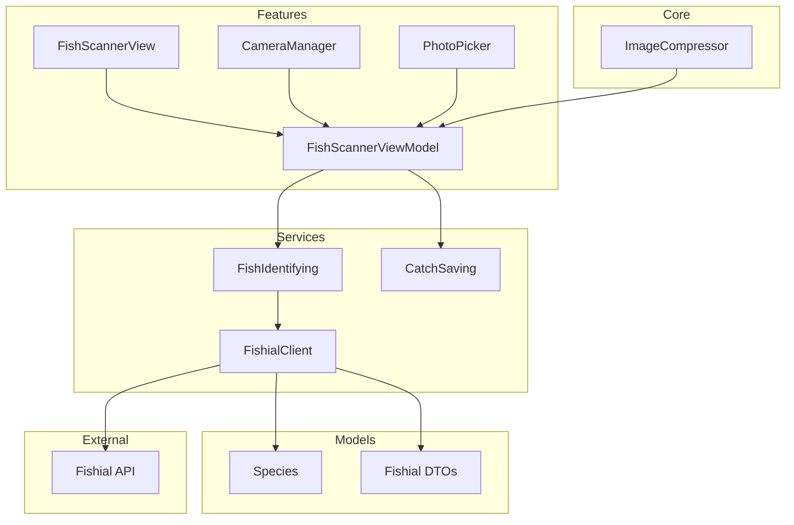
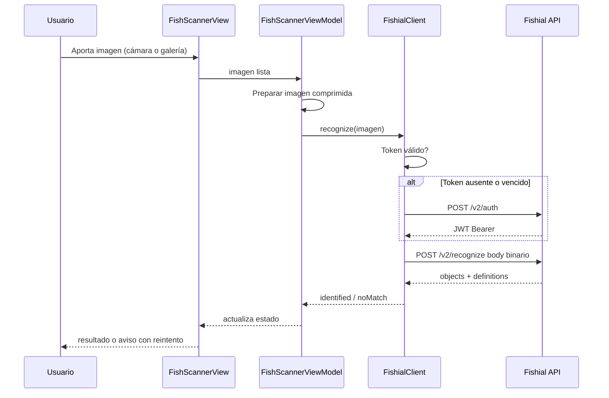

# Design Document: fish-species-identification

---
**Purpose**: Proporcionar suficiente detalle para una implementación consistente y sin deriva de interpretación entre implementadores.
**Enfoque**: Secciones esenciales que informan decisiones de implementación; diagramas y tablas sobre prosa extensa.
---

## Overview

Esta feature permite a un pescador identificar la especie de un pez al instante a partir de una fotografía tomada en el momento (cámara) o seleccionada del carrete (galería). La imagen se envía a la API de reconocimiento Fishial.ai y la app presenta el nombre de la especie (común en inglés y científico en latín) con un aviso cuando el resultado no es fiable. Desde el resultado, el usuario puede guardar la captura con la especie pre-rellena, entregando el draft al flujo de Registro de capturas.

**Users**: Pescadores sin experiencia que han capturado una especie que no reconocen y quieren saber qué es sin recurrir a guías o foros.

**Impact**: Crea de cero la capability de identificación de especies dentro de la app iOS, añadiendo el primer cliente de la API externa de Fishial.ai y el primer seam de integración hacia Registro de capturas.

### Goals
- Identificar la especie de un pez a partir de una foto (cámara o galería) con resultado en segundos y estado de carga visible.
- Diferenciar claramente resultado fiable, confianza baja y ausencia de coincidencia, ofreciendo reintento.
- Permitir guardar la captura identificada con la especie pre-rellena vía seam `CatchSaving`.
- Definir el contrato `FishIdentifying` para permitir cambiar de proveedor sin tocar la UI.

### Non-Goals
- Información de especie (características, normativa, talla mínima, temporada) — capability "Información de especie".
- Persistencia completa de capturas (historial, edición, sincronización) — capability "Registro de capturas"; esta spec solo acuerda el seam `CatchSaving`.
- Detección multi-especie por foto; identificación offline (Core ML) — diferido.

## Boundary Commitments

### This Spec Owns
- Flujo completo de escaneo: captura cámara/galería, preparación de imagen, identificación vía Fishial.ai, clasificación de confianza (fiable / baja / sin coincidencia) y presentación de resultados con reintento.
- Contrato público `FishIdentifying` (seam de intercambio de proveedor) y su implementación `FishialClient`, incluida la gestión de token JWT (caché + refresh).
- Modelos de dominio `Species` y DTOs de Fishial (Codable) que cruzan la red.
- Contrato `CatchSaving`: responsible de entregar el draft de captura (especie + foto) al Registro de capturas. Esta spec define el protocolo y una implementación provisional **persistente** `LocalDraftCatchSaver` que guarda borradores localmente (Application Support, preferencias) para que los criterios de Req 4 sean funcionalmente verificables hasta que "Registro de capturas" aporte la implementación definitiva.

### Out of Boundary
- Persistencia, historial, edición o sincronización de capturas (los implementa "Registro de capturas").
- Datos regulatorios/descriptivos de especies.
- Decisión de suscripción/pago o SLAs con Fishial.ai.
- Reemplazo del proveedor de identificación (el protocolo lo permite; la impl. de iNaturalist/otro es trabajo futuro).

### Allowed Dependencies
- API externa Fishial.ai (`https://api-recognition.fishial.ai`, endpoints `/v2/auth` y `/v2/recognize`).
- Frameworks del sistema: SwiftUI, AVFoundation, PhotosUI/Photos, CoreGraphics, Observation, UIKit (bridging).
- Capa `Core` compartida (`ImageCompressor`).
- Tools de desarrollo: Xcode 16+ (Swift 6), iOS 17+; sin librerías de terceros nuevas.

### Revalidation Triggers
- Cambio de forma del contrato de respuesta/errores de Fishial.ai (fields, umbrales, auth).
- Cambio de datos que esta spec considera autoritativos (géneros/IDs de especie) o del seam `CatchSaving`.
- Cambio de dirección de dependencias (p. ej., si "Registro de capturas" pasa a depender de esta feature).
- Cambio en el tiempo de respuesta exigido (Req 5) que afecte timeouts o estados de carga.

## Architecture

### Architecture Pattern & Boundary Map

MVVM por feature (alineado con `structure.md`): una View y un ViewModel `@Observable` por feature; el ViewModel orquesta los Services; los Services detrás de protocolos; los modelos Codable viven en `/Models`; Core aloja utilidades compartidas. Dependencias: Features → Services → Core → Models.



**Architecture Integration**:
- **Selected pattern**: MVVM por feature con Services tras protocolos (steering).
- **Domain/feature boundaries**: `FishScanner` (esta feature) no conoce la persistencia de capturas; se comunica con el Registro de capturas únicamente por el protocolo `CatchSaving`.
- **Existing patterns preserved**: `structure.md` (carpetas feature-first, MVVM), `tech.md` (Servicios tras protocolos, modelos Codable en `/Models`).

### Technology Stack

| Layer | Choice / Version | Role in Feature | Notes |
|-------|------------------|-----------------|-------|
| Frontend | SwiftUI, iOS 17+ | Vistas del escáner y estados de carga | `@Observable` ViewModels; `PhotosPicker` |
| Camera | AVFoundation (AVCaptureSession/PhotoOutput) + `UIViewRepresentable` | Captura de foto del pez | `videoRotationAngle` (iOS 17); sesión en cola serial |
| Service | Fishial.ai REST v2 (external) | Identificación de especie | Body binario raw; Bearer JWT 600 s |
| Networking | URLSession + async/await | Cliente HTTP de Fishial.ai | Sin Alamofire |
| Data / Storage | Ninguno en esta spec | Resultado efímero en memoria | Persistencia delegada al seam `CatchSaving` |

## File Structure Plan

### Directory Structure
```
App/
├── Features/
│   └── FishScanner/
│       ├── FishScannerView.swift        # Punto de entrada: elegir cámara/galería, estados, resultado, aviso y guardado
│       ├── FishScannerViewModel.swift   # @Observable: máquina de estados del flujo y orquestación de Services
│       ├── CameraManager.swift          # @Observable @MainActor: AVCaptureSession, permisos y shutter
│       ├── CameraView.swift             # UIViewRepresentable que expone la preview de la cámara
│       └── PhotoPickerView.swift        # Wrapper de PhotosPicker (galería)
├── Services/
│   └── FishID/
│       ├── FishIdentifying.swift        # Protocolo: seam de proveedor de identificación
│       ├── FishialClient.swift          # Impl concreta: auth token + recognize + mapeo a dominio
│       ├── FishialTokenStore.swift      # Caché de token JWT con expiración y renew
│       ├── CatchSaving.swift            # Protocolo seam hacia Registro de capturas
│       └── LocalDraftCatchSaver.swift   # Provisional: persiste draft local (especie + foto) en Application Support
├── Core/
│   └── Image/
│       └── ImageCompressor.swift        # Resize (máx 1280 px) + JPEG 0.7; tolerancia < 20 MB
└── Models/
    ├── Species.swift                    # Modelo de dominio compartido (id, commonName, scientificName, localizedName, imagen)
    ├── CatchDraft.swift                 # Registro provisional de captura (species, ruta de foto, fecha, estado)
    └── Fishial/
        ├── FishialToken.swift           # Respuesta de /v2/auth
        └── FishialRecognition.swift     # Respuesta de /v2/recognize (objects, definitions) y tipos de resultado
```

### Modified Files
- `App/Resources/Info.plist` (o esquema del target) — añadir `NSCameraUsageDescription` (razón para cámara). Sin entrada de librería de fotos (PhotosPicker no la requiere) ni de "añadir a fotos" (no se guarda en carrete).
- Composition root de la app (punto de entrada) — construir e inyectar `FishialClient` (con credenciales desde configuración de entorno) e implementación provisional de `CatchSaving` en `FishScannerViewModel`.

## System Flows

Flujo principal de escaneo (cámara o galería comparten el mismo camino tras aportar la imagen):



Decisión de confianza tras la respuesta: `objects` vacío → `noMatch`; `certainty >= 0.55` → fiable; `0.30 <= certainty < 0.55` → aviso de confianza baja (aun así se muestra la especie principal con advertencia). El guardado solo se ofrece cuando hay una especie; si falla, se informa y se permite reintentar.

## Requirements Traceability

| Requirement | Summary | Components | Interfaces | Flows |
|-------------|---------|------------|------------|-------|
| 1.1 | Ofrecer cámara o galería al iniciar escaneo | FishScannerView | State | Flujo escaneo |
| 1.2 | Foto de cámara pasada a identificación | CameraManager, CameraView, FishScannerViewModel | State | Flujo escaneo |
| 1.3 | Imagen de galería pasada a identificación | PhotoPickerView, FishScannerViewModel | State | Flujo escaneo |
| 1.4 | Cancelación vuelve al estado anterior | FishScannerView, FishScannerViewModel | State | Flujo escaneo |
| 1.5 | Permiso de cámara ausente: informar y guiar a Settings | CameraManager, FishScannerView | — | — |
| 2.1 | Imagen lista inicia identificación | FishScannerViewModel, FishIdentifying, FishialClient, ImageCompressor | Service, API | Flujo escaneo |
| 2.2 | Confianza suficiente: mostrar nombre de especie | FishScannerViewModel, FishIdentifying, Species | Service | Flujo escaneo |
| 2.3 | Una única especie por imagen | FishialClient (primera candidata del mejor objeto), FishScannerViewModel | Service | — |
| 3.1 | Sin coincidencia: aviso de no identificación | FishialClient, FishScannerViewModel, FishScannerView | Service | Resultado no fiable |
| 3.2 | Confianza baja: aviso de fiabilidad | FishialClient (umbral), FishScannerViewModel | Service | Resultado no fiable |
| 3.3 | Ofrecer reintento con otra foto | FishScannerView, FishScannerViewModel | State | Resultado no fiable |
| 3.4 | Error en identificación: mensaje y reintento | FishialClient, FishScannerViewModel | API | Resultado no fiable |
| 4.1 | Guardar con especie pre-rellena | FishScannerViewModel, CatchSaving, LocalDraftCatchSaver | Service | Guardado |
| 4.2 | Fallo de guardado: informar y reintentar | CatchSaving, LocalDraftCatchSaver, FishScannerViewModel | Service | Guardado |
| 5.1 | Estado de carga durante identificación | FishScannerView, FishScannerViewModel | State | Flujo escaneo |
| 5.2 | Resultado en cuestión de segundos | FishialClient (timeout 15 s), FishScannerViewModel | API, Service | Flujo escaneo |
| 5.3 | Cancelación de identificación en curso | FishScannerView, FishScannerViewModel | State | Flujo escaneo |

## Components and Interfaces

| Component | Domain/Layer | Intent | Req Coverage | Key Dependencies (P0/P1) | Contracts |
|-----------|--------------|--------|--------------|--------------------------|-----------|
| FishScannerView | UI | Pantalla del flujo: fuente, carga, resultado, avisos, guardado | 1, 3, 4, 5 | FishScannerViewModel | State |
| FishScannerViewModel | UI | Orquestación y máquina de estados del escaneo | 1–5 | FishIdentifying (P0), CatchSaving (P0), ImageCompressor (P1) | Service, State |
| CameraManager | UI/AV | Sesión de cámara, permisos, foto capturada | 1.2, 1.5 | AVFoundation | State |
| CameraView | UI/AV | Preview de cámara en SwiftUI | 1.2 | CameraManager | State |
| PhotoPickerView | UI | Selección de imagen de galería | 1.3 | PhotosUI | State |
| ImageCompressor | Core | Resize + compresión JPEG previa a subida | 2.1 | CoreGraphics, UIKit | Service |
| FishIdentifying | Service | Seam de proveedor de identificación | 2, 3 | — | Service |
| FishialClient | Service | Auth JWT + recognize + mapeo a dominio | 2.1, 2.2, 2.3, 3.1, 3.2, 3.4, 5.2 | FishialTokenStore (P0), Models | API, Service |
| FishialTokenStore | Service | Caché y renovación del token Bearer | 3.4, 5.2 | URLSession | State |
| CatchSaving | Service | Seam hacia Registro de capturas | 4 | — | Service |
| LocalDraftCatchSaver | Service | Provisional: persiste el draft de captura localmente | 4.1, 4.2 | FileManager, Models | Service |
| Species / CatchDraft / Fishial DTOs | Models | Tipos Codable de dominio y red | 2, 3, 4 | — | — |

### UI Layer

#### FishScannerView
| Field | Detail |
|-------|--------|
| Intent | Presenta el flujo completo de escaneo y sus estados |
| Requirements | 1.1, 1.3, 1.4, 3.3, 4.1, 5.1, 5.3 |

**Implementation Notes** (summary-only; sin límites nuevos):
- Integration: muestra opciones cámara/galería cuando `state == .idle`; estados de carga/resultado/aviso mapeados desde el ViewModel; guardado solo visible con especie identificada.
- Validation: todos los estados derivan del ViewModel; no contiene llamadas a red ni lógica de dominio.
- Riesgos: la vista de cámara debe detener la sesión en `onDisappear` para no dejar la cámara activa.

#### CameraView
| Field | Detail |
|-------|--------|
| Intent | Expone `AVCaptureVideoPreviewLayer` en SwiftUI |
| Requirements | 1.2 |

**Implementation Notes**: `UIViewRepresentable` con `layerClass` override (evita frame cero) y `session` inyectada desde `CameraManager`.

#### PhotoPickerView
| Field | Detail |
|-------|--------|
| Intent | Wrapper de `PhotosPicker` (sin permiso de librería) |
| Requirements | 1.3 |

**Implementation Notes**: `matching: .images`; carga vía `loadTransferable(type: Data.self)` en `task(id:)`; entrega los datos al ViewModel.

### State Layer

#### FishScannerViewModel
| Field | Detail |
|-------|--------|
| Intent | Único orquestador del flujo: estados, acciones y llamadas a Services |
| Requirements | 1.1–5.3 |

**Responsibilities & Constraints**
- Máquina de estados: `idle → imageReady → identifying → completed(Species±confidence)` / `noMatch` / `failed(message)`; con `cancelled` desde `identifying`. El guardado se modela aparte: `saving / saved / saveFailed`.
- ownership de una única imagen a la vez (2.3): si el usuario aporta una nueva imagen, cancela la anterior.
- Inbound/exposición solo vía `@Observable` properties y acciones del usuario; no accede a `FishialClient` directamente (vía protocolo `FishIdentifying`).
- Data ownership: resultado de identificación efímero en memoria; no persiste nada.

**Dependencies**
- Outbound: `FishIdentifying` — reconocimiento (P0).
- Outbound: `CatchSaving` — guardado del draft (P0).
- Outbound: `ImageCompressor` — preparar datos de subida (P1).

**Contracts**: Service [x] / API [ ] / Event [ ] / Batch [ ] / State [x]

##### Service Interface
```swift
@MainActor
@Observable
final class FishScannerViewModel {

    enum ScanState: Equatable {
        case idle
        case imageReady
        case identifying
        case identified(IdentificationResult)
        case noMatch
        case failed(message: String)
    }

    enum SaveState: Equatable { case idle, saving, saved, saveFailed }

    var scanState: ScanState { get }
    var saveState: SaveState { get }

    func setImage(data: Data)                     // 1.2/1.3 → imageReady
    func cancelCapture()                          // 1.4, 5.3
    func startIdentification() async              // 2.1 (auto en imageReady)
    func retryWithAnotherPhoto()                  // 3.3 → idle
    func saveCapturedCatch() async                // 4.1
}
```
- Preconditions: `startIdentification` requiere `imageReady`; `saveCapturedCatch` requiere `identified`.
- Postconditions: tras `startIdentification`, el estado pasa a `identifying` y termina en `identified/noMatch/failed`.
- Invariantes: como máximo una identificación en curso; `saveState == .saving` solo mientras hay una especie identificada.

#### CameraManager
| Field | Detail |
|-------|--------|
| Intent | Gestiona `AVCaptureSession`, permisos de cámara y captura de una foto |
| Requirements | 1.2, 1.5 |

**Responsibilities & Constraints**
- `@MainActor @Observable`; sesión configurada en una `DispatchQueue` serial; `startRunning()/stopRunning()` controlados.
- Solicita permiso en el momento de uso (1.5); si está denegado, expone `cameraAccessDenied` para que la vista guíe a Settings.

**Contracts**: State [x]

##### State Management
- Estado: `isRunning`, `cameraAccessDenied: Bool?` (nil = no solicitado).
- Captura: método async `capturePhoto() async -> Data?` (CheckedContinuation sobre `AVCapturePhotoCaptureDelegate`).
- Concurrency: llamadas a la sesión en la cola serial; estados leídos en main actor.

### Services Layer

#### FishIdentifying
| Field | Detail |
|-------|--------|
| Intent | Seam de proveedor: desacopla la UI del proveedor concreto |
| Requirements | 2, 3 |

**Contracts**: Service [x]

##### Service Interface
```swift
protocol FishIdentifying: Sendable {
    func recognize(imageData: Data) async throws -> IdentificationOutcome
}
```
- Preconditions: `imageData` ya comprimida (JPEG, < 20 MB).
- Postconditions: devuelve `IdentificationOutcome` clasificado (identified / noMatch) sin lanzar los errores HTTP internos (se mapean a `failed` en el cliente).
- Invariantes: solo la primera candidata del mejor objeto se traduce a `Species` (2.3).

#### FishialClient
| Field | Detail |
|-------|--------|
| Intent | Implementación de `FishIdentifying` contra la API de Fishial.ai |
| Requirements | 2.1, 2.2, 2.3, 3.1, 3.2, 3.4, 5.2 |

**Responsibilities & Constraints**
- Obtiene token vía `FishialTokenStore` y llama a `POST /v2/recognize` con la imagen como body binario y `Content-Type: image/jpeg`.
- Decodifica con `JSONDecoder` + `convertFromSnakeCase`; tolera respuestas no JSON del edge (HTML/plain) mapeándolas a error genérico.
- Aplica umbrales: `>= 0.55` fiable, `0.30..<0.55` confianza baja (la especie se muestra con aviso), `< 0.30` o `objects` vacío → `noMatch`.
- Mapea `definitions` → `Species` dejando `localizedName` a `nil` (por ahora sin traducción propia).
- Reintento único automático sobre HTTP 401 `auth_token_expired` (renueva token y repite la llamada).

**Dependencies**
- Outbound: `FishialTokenStore` — token Bearer (P0).
- External: Fishial.ai — auth y recognize (P0).

**Contracts**: Service [x] / API [x]

##### API Contract
| Method | Endpoint | Request | Response | Errors |
|--------|----------|---------|----------|--------|
| POST | /v2/auth (external) | JSON `{client_id, client_secret}` | `{token_type, access_token}` | 401 invalid_client |
| POST | /v2/recognize (external) | Body binario de imagen; `Authorization: Bearer`; `Content-Type: image/jpeg` | `FishialRecognitionResponse` | 401, 413, 415, 422, credits_insufficient |

##### State Management
- Token cacheado por `FishialTokenStore` con TTL 600 s y renovación perezosa; nunca se expone al ViewModel.

**Implementation Notes**
- Integration: el requerimiento `Fishial-Location-Lat-Lon` se omite en esta iteración (sin ubicación obligatoria).
- Validation: validar mapeo de `definitions` por UUID; respuesta con `objects: []` → `noMatch`.
- Riesgos: variabilidad de errores no JSON del edge; contenido de `commonName` en inglés (se muestra tal cual, HTML-escape sin issue en SwiftUI).

#### FishialTokenStore
| Field | Detail |
|-------|--------|
| Intent | Caché y renovación del JWT Bearer de Fishial.ai |
| Requirements | 3.4, 5.2 |

**Contracts**: State [x]

##### State Management
- Estado: `token: String?` + `expiresAt: Date`.
- Semántica: `validToken()` devuelve el token si `now < expiresAt - 60s`; si no, llama a `/v2/auth` y guarda el nuevo token. Concurrencia serializada para evitar auths duplicados.

#### CatchSaving
| Field | Detail |
|-------|--------|
| Intent | Seam hacia Registro de capturas; entrega species + foto y devuelve éxito/fallo |
| Requirements | 4.1, 4.2 |

**Contracts**: Service [x]

##### Service Interface
```swift
protocol CatchSaving: Sendable {
    func saveDraft(species: Species, photoData: Data) async throws
}
```
- Preconditions: `species` identificada y `photoData` JPEG.
- Postconditions: si no lanza, la captura quedó registrada como borrador local con la especie pre-rellena (4.1). Cualquier fallo de infraestructura se propaga como `CatchSaveError` para el aviso y reintento (4.2).
- Invariantes: esta spec no define la persistencia definitiva; el composition root inyecta `LocalDraftCatchSaver` (provisional) hasta que "Registro de capturas" aporte la definitiva.

#### LocalDraftCatchSaver
| Field | Detail |
|-------|--------|
| Intent | Implementación provisional (`CatchSaving`) de borrador local persistente |
| Requirements | 4.1, 4.2 |

**Responsibilities & Constraints**
- En `Application Support/ProvisionalDrafts/`: escribe el JPEG en `<uuid>.jpg` y un `CatchDraft` JSON (species + ruta de foto + `createdAt` + `status: .draft`) en `<uuid>.json`.
- Determinista y sin dependencias externas: `saveDraft` crea los ficheros de forma atómica (write + rename); si falla, propaga `CatchSaveError` (4.2).
- Expone operaciones soporte (listado/borrado) solo si las requiere el flujo de confirmación de la vista; mínimo viable para cumplir 4.1.
- Es reemplazable por el Registro de capturas sin cambios en el protocolo ni en el ViewModel.

### Core Layer

#### ImageCompressor
| Field | Detail |
|-------|--------|
| Intent | Preparar la imagen para subida: resize máx 1280 px + `jpegData(0.7)` |
| Requirements | 2.1 |

**Implementation Notes**: `UIGraphicsImageRenderer` preserva orientación; garantiza < 20 MB de Fishial; si la compresión falla, lanza `ImagePrepError` (se traduce a `failed`).

## Data Models

### Domain Model
- `Species` es un value object compartido: id de la especie como identidad canónica en Fishial; `commonName` inglés; `scientificName` latín; `localizedName` opcional (nombre popular en español, inicialmente nil); `referenceImageURL` opcional. `localizedName` queda preparado para que la futura capability "Información de especie" aporte la traducción sin cambiar el modelo.
- `CatchDraft` es el registro provisional de captura (species, ruta local de la foto, `createdAt`, `status`) que produce `LocalDraftCatchSaver`; no es el modelo definitivo de capturas.
- `IdentificationResult` y `IdentificationOutcome` son monedas del flujo, efímeras.
- No hay entidades persistentes definitivas en esta spec; la persistencia real (tabla de capturas) es responsabilidad del Registro de capturas.

### Logical Data Model
- `FishialRecognitionResponse` 1:N a `objects`; cada `FishialObject` 1:N a `species` (candidatas con `certainty`); `definitions` mapea UUID → `FishialSpeciesDefinition`.
- Identificadores canónicos: UUID de especie en Fishial → `Species.id`.
- `CatchDraft` (Codable, provisional): `id` (UUID del fichero), `species: Species`, `photoPath: String` (relativa a Application Support/ProvisionalDrafts), `createdAt: Date`, `status: CatchDraftStatus` (`.draft`). Cardinalidad 1:1 draft→foto.

### Data Contracts & Integration
**API Data Transfer** (DTOs Codable, JSON snake_case):
```swift
struct FishialTokenResponse: Decodable {
    let tokenType: String?
    let accessToken: String
}

struct FishialRecognitionResponse: Decodable, Sendable {
    let ok: Bool
    let queryToken: String?
    let objects: [FishialObject]
    let definitions: [String: FishialSpeciesDefinition]
}

struct FishialObject: Decodable, Sendable {
    let bbox: [Double]?
    let shape: [Double]?
    let species: [FishialSpeciesCandidate]
}

struct FishialSpeciesCandidate: Decodable, Sendable {
    let id: String
    let certainty: Double
}

struct FishialSpeciesDefinition: Decodable, Sendable {
    let commonName: String
    let scientificName: String
    let imageUrl: String?
}
```
- `Species` (dominio, Codable, Identifiable, Hashable): `id`, `commonName`, `scientificName`, `localizedName: String?`, `referenceImageURL`.
- `CatchDraft` (Codable, Sendable): `id`, `species: Species`, `photoPath: String`, `createdAt: Date`, `status: CatchDraftStatus` (`enum CatchDraftStatus: String, Codable { case draft }`).
- Serialización: `JSONDecoder.keyDecodingStrategy = .convertFromSnakeCase`.

## Error Handling

### Error Strategy
- **Fail fast**: se valida la imagen comprimida (no nil, JPEG) antes de salir a la red.
- **Graceful degradation**: ante fallo de identificación se muestra mensaje con reintento; ante fallo de guardado se mantiene la especie en pantalla (no se pierde el resultado).
- **User context**: mensajes accionables ("comprueba tu conexión", "habilita la cámara en Ajustes", "intenta con otra foto").

### Error Categories and Responses
**User Errors**:
- Permiso de cámara denegado → pantalla con acción "Abrir Ajustes" (`UIApplication.openSettingsURLString`). (1.5)
- Cancelación de captura/selección o de identificación → volver a `idle` sin mensaje. (1.4, 5.3)
- Imagen no comprimible → `failed("No se pudo procesar la imagen")` con reintento. (3.4)

**System Errors**:
- Timeout / sin conexión en recognize → `failed("No se pudo conectar")` con reintento. Timeout concreto: `URLRequest.timeoutInterval = 15` (request completo); sin reintento automático salvo renovación de token. (5.2)
- HTTP 401 → renovar token y reintentar una vez; si persiste, `failed`. (3.4)
- HTTP 413/415/422 → degradación a `failed` (la preparación debería evitar estos casos). (3.4)
- Respuesta no JSON del edge → error genérico tolerante. (3.4)

**Business Logic Errors**:
- `objects: []` → `noMatch` (no es error, pero se trata como resultado). (3.1)
- `certainty` baja → especie mostrada con aviso de fiabilidad. (3.2)

### Monitoring
- Log (os.Logger) de: llamadas a recognize con resultado (fiable/baja/noMatch), renovaciones de token, timeouts y respuestas no JSON.
- Métricas de telemetría fuera de alcance de esta spec; los logs son suficientes para diagnóstico inicial.

## Testing Strategy

### Unit Tests
- Decodificación de `FishialRecognitionResponse`: response válido, `objects: []`, definiciones incompletas y snake_case; mapeo a `IdentificationOutcome`.
- Clasificación de confianza en `FishialClient`: `certainty >= 0.55` → fiable; `0.30..<0.55` → baja; `< 0.30` y `objects` vacío → `noMatch` (cubre 2.3, 3.1, 3.2).
- `FishialTokenStore`: token vigente se reutiliza, vencido fuerza `/v2/auth`, y no genera auths duplicados en concurrencia (cubre 3.4, 5.2).
- Máquina de estados de `FishScannerViewModel`: transiciones `imageReady→identifying→identified/noMatch/failed`, cancelación durante `identifying`, `saveCapturedCatch` solo desde `identified` (cubre 1.4, 2.1, 4.1, 5.3).
- `ImageCompressor`: dimensión ≤ 1280 px, JPEG ≤ 20 MB en una imagen grande de prueba (cubre 2.1).
- `LocalDraftCatchSaver` (provisional `CatchSaving`): `saveDraft` escribe el JSON `CatchDraft` con la especie pre-rellena y el JPEG, y propaga `CatchSaveError` si el write/rename falla (cubre 4.1, 4.2).
- Mapeo DTO → `Species`: `localizedName` queda `nil` y el resto de campos se propagan correctamente (cubre 2.2).

### Integration Tests
- `FishialClient` con URLSession mockeada: éxito 200 + decodificación; 401 → renovación de token → reintento; 413/415/422 → mapeo a `failed`; respuesta HTML/plain → error genérico (cubre 3.4, 5.2).
- `LocalDraftCatchSaver` end-to-end con FileManager real (directorio temporal de pruebas): persistencia y relectura del draft con la especie correcta; gestión de rutas de foto (cubre 4.1, 4.2).

### E2E/UI Tests (UI XCTest)
- Flujo cámara: permiso concedido → captura → identificado (mock del cliente) → resultado visible (cubre 1.2, 1.5, 2.2, 5.1).
- Flujo galería: selección → identificado con confianza baja → aviso visible (cubre 1.3, 3.2).
- Flujo sin coincidencia: `noMatch` → aviso + botón de retry → nueva imagen (cubre 3.1, 3.3).
- Flujo guardado: identificado → guardar → éxito; y guardar fallido → mensaje + reintento (cubre 4.1, 4.2).

### Performance/Load
- `ImageCompressor` produce los datos de subida en < ~1 s sobre una foto de cámara típica (medible en unit/integration).
- `FishialClient.recognize` mantiene el resultado dentro del timeout de sesión configurado (responde a la expectativa de Req 5.2 de "segundos"); sin concurrencia añadida en esta iteración.

## Optional Sections

### Security Considerations
- Credenciales de Fishial (`client_id`/`client_secret`) en configuración de entorno (`.xcconfig`) fuera del código y del repositorio; nunca en UserDefaults de usuario.
- El token Bearer vive solo en memoria (`FishialTokenStore`), no se persiste.
- Contenido de imagen tratado como dato del usuario: no se loguea la imagen ni su metadata.

### Performance & Scalability
- Objetivo observable de Req 5.2: resultado en cuestión de segundos gracias a timeout de URLSession razonable + preparación de imagen previa a la subida.
- Sin estado compartido entre llamadas (token salvo caché con renew); la escalabilidad de Fishial es responsabilidad del proveedor.

## Supporting References
- Detalles de investigación y comparativa de proveedores: `research.md` en `.kiro/specs/fish-species-identification/`.
- Documentación Fishial.ai: https://docs.fishial.ai/api