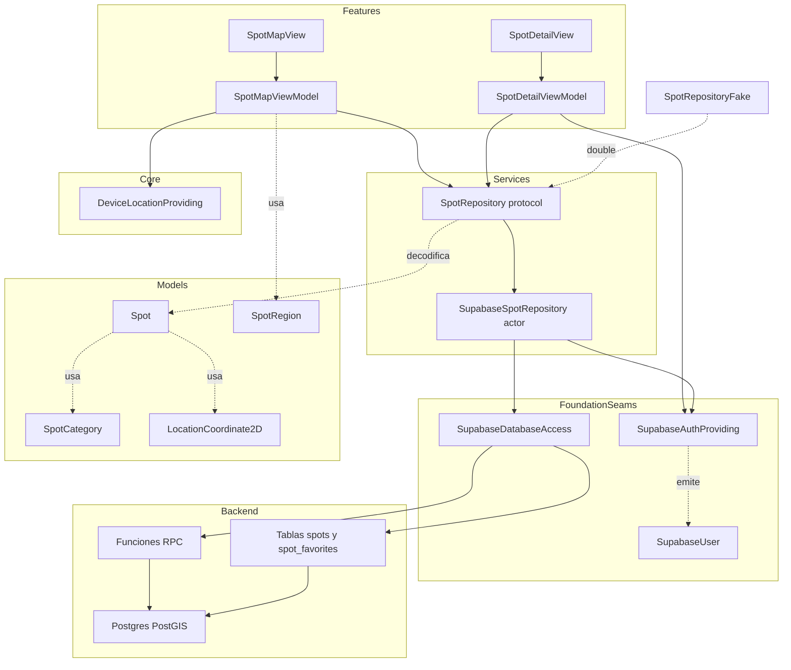
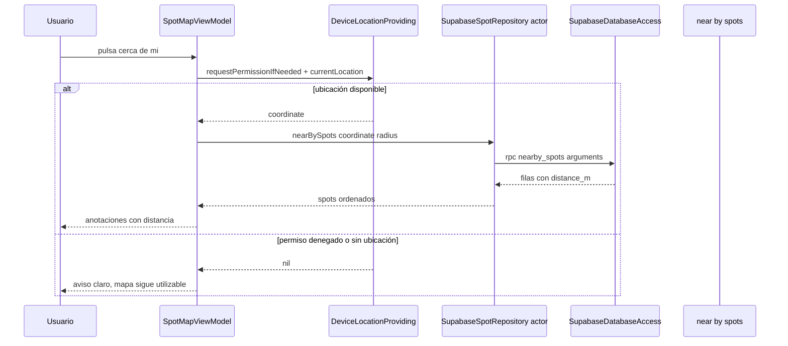
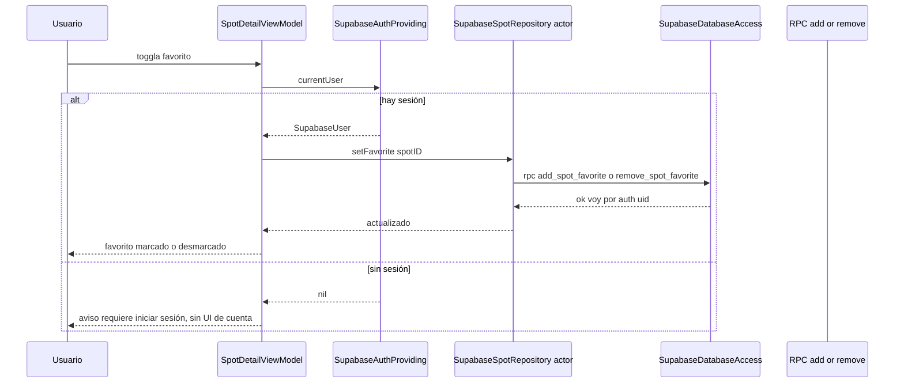

# Design Document: spot-discovery

---
**Purpose**: Proporcionar suficiente detalle para una implementación consistente y sin deriva de interpretación entre implementadores del mapa de spots, los favoritos y el repositorio de spots sobre Supabase/PostGIS.
**Enfoque**: Secciones esenciales que informan decisiones de implementación; diagramas y tablas sobre prosa extensa.
---

## Overview

Esta feature entrega la capacidad de descubrir puntos de pesca en un mapa. Hoy el pescador solo puede identificar especies y registrar capturas localmente; no existe ninguna visualización de mapa ni spots, y la capa de datos compartida («supabase-foundation») aún no está construida y precede a esta feature en el roadmap. Con spot-discovery, el usuario verá en una pestaña «Mapa» los spots curados de una semilla (geometría PostGIS + columnas de coordenadas) como anotaciones de MapKit, con acceso anónimo; podrá solicitar «spots cerca de mí» desde su ubicación (ordenados por distancia), seleccionar un spot y consultar su detalle básico, y marcar favoritos asociados a su cuenta cuando haya una sesión activa.

**Users**: El pescador que planifica salidas (descubrir sitios y ver los más cercanos); indirectamente, el usuario autenticado que quiere conservar sus favoritos y la spec downstream «account-personal» que reutiliza los favoritos.

**Impact**: Introduce la primera UI de mapa de la app, el primer consumidor real de los seams de base de datos y de autenticación de «supabase-foundation», y el primer provisioning de esquema/RLS/PostGIS de la app (directorio `db/`). No modifica los seams de `catch-log` ni `fish-species-identification`.

### Goals
- Pestaña «Mapa» con spots curados como anotaciones, accesible sin sesión ni permiso de ubicación.
- «Spots cerca de mí» con ordenación por distancia real (PostGIS) desde la ubicación del dispositivo.
- Selección de spot → detalle básico (nombre, categoría, resumen, coordenadas) sin autenticación.
- Favoritos asociados a la cuenta mediante auth de la capa base, con gate de sesión sin UI de login y con reutilización por «account-personal».
- Seam `SpotRepository` tras protocolo (inyectable/sustituible por doble) que consume `SupabaseDatabaseAccess`/`SupabaseAuthProviding` sin filtrar tipos del SDK.
- Degradación elegante cuando no hay capa de datos disponible (stack nil de la base).

### Non-Goals
- Subida de spots por usuarios, moderación, rating ni cuenta de pago.
- Datos regulatorios de especie asociados a spots (talla/normativa).
- UI de login, registro o perfil (spec «account-personal»); los favoritos solo avisan de que se requiere sesión.
- Sincronización del registro de capturas ni migración de datos (spec «account-personal»).
- Persistencia local de spots o favoritos en el dispositivo.
- Cambio de seams existentes (`CatchRepository`, `CatchSaving`, `FishIdentifying`, `DeviceLocationProviding`) ni de los seams de «supabase-foundation».

## Boundary Commitments

### This Spec Owns
- El protocolo `SpotRepository` (geografía, lecturas y favoritos) y el actor `SupabaseSpotRepository` que lo implementa sobre los seams de la base.
- Los modelos `Spot`, `SpotCategory` y `SpotRegion` (`Codable`/`Sendable`), centralizando el mapeo de los datos de spots.
- La pestaña «Mapa» de la navegación raíz y sus vistas: `SpotMapView`, `SpotDetailView`, `SpotMapViewModel`, `SpotDetailViewModel`.
- El provisioning de base de datos del dominio de spots: tablas `spots` y `spot_favorites`, índices GiST, RLS, funciones RPC (`nearby_spots`, `my_favorite_spot_ids`, `my_favorite_spots`, `add_spot_favorite`, `remove_spot_favorite`) y la semilla curada, versionado en `db/spot-discovery/`.
- Los dobles y tests de la feature (`SpotRepositoryFake`, tests de ViewModels, tests del repositorio, tests de composición) y el `SpotMapUITests` del flujo crítico.
- La decisión de guardar `longitude`/`latitude` numéricas junto a `geom` PostGIS para lecturas planas y distancia por RPC.

### Out of Boundary
- UI/UX de cuenta (login/registro/perfil): esta spec solo muestra el aviso de «requiere iniciar sesión» para favoritos.
- Subida de spots, moderación, rating, cuentas de pago y datos regulatorios de especie.
- Sync del registro de capturas y favoritos de la cuenta gestionados por «account-personal» (estos últimos consumirán el mismo `SpotRepository`).
- Ampliación de los seams de «supabase-foundation» (incluso insert/update/delete en la base de datos) — solo se consumen `select`/`rpc`/auth.
- Cambios en los seams de `catch-log` y `fish-species-identification`.
- Persistencia local de spots o favoritos.

### Allowed Dependencies
- **`supabase-foundation`** (upstream): seams `SupabaseDatabaseAccess` (`select`/`rpc`) y `SupabaseAuthProviding` (`currentUser()`, `stateChanges()`), y el modelo común `SupabaseUser`. No se consume `SupabaseStoring` ni la capa conoce tipos del SDK.
- **`App/Core`** compartido: `DeviceLocationProviding`/`DeviceLocationProvider` (localización) y el modelo `LocationCoordinate2D` (Modelos compartidos). La conversión a `MKCoordinateRegion` queda aislada en la capa de vista.
- **Sistema**: SwiftUI, MapKit, CoreLocation, Foundation, os (Logger).
- **Backend propio**: Postgres + PostGIS y las funciones RPC/tablas de `db/spot-discovery` (provisioning de esta spec).
- **Prohibido**: depender de seams de `catch-log` (`CatchRepository`/`CatchSaving`) o de `fish-species-identification` (`FishIdentifying`); librerías de terceros nuevas.

### Revalidation Triggers
- Cambio del contrato `SpotRepository` (firmas, tipos emitidos) — afecta a «account-personal» que reutiliza los favoritos.
- Cambio de los modelos `Spot`, `SpotCategory`, `SpotRegion` (campos, tipado).
- Cambio del esquema de `spots`/`spot_favorites`, de la semilla o de las firmas/formas JSON de las funciones RPC.
- Cambio del gate de autenticación de los favoritos (si dejan de requerir cuenta) o de la degradación esperada sin capa de datos.
- Cambio en la dirección de dependencias (si la feature pasara a depender de `catch-log`/`fish-species` o del SDK directamente).

## Architecture

### Existing Architecture Analysis

La app usa MVVM por feature (structure.md): Views bajo `App/Features/<Feature>/` con sus ViewModels, Services detrás de protocolos en `App/Services/`, modelos `Codable` en `App/Models/`, composición única en `AppComposition`/`AppRootServices`, pestañas en `RootView` (`BetterFishingApp.swift`). Patrones ya probados: repositorio tras protocolo con actor/fake (`CatchRepository`, `LocalFileCatchRepository`), seams de localización en `App/Core/Location` con fakes en tests, `SupabaseBaseFake` en el test target de la base para no contactar la red, y stubs HTTP (`MockURLProtocol`/`HTTPStub`). El `NSLocationWhenInUseUsageDescription` ya existe en Info.plist (no se añade permiso nuevo). La navegación raíz usa `TabView` con dos pestañas; esta feature añade una tercera sin tocar las existentes.

### Architecture Pattern & Boundary Map

Patrón de repositorio tras protocolo extendido a la geografía/PostGIS: el ViewModel depende solo del protocolo `SpotRepository` y de `DeviceLocationProviding`; `SupabaseSpotRepository` traduce operaciones de dominio a `SupabaseDatabaseAccess` (select/RPC) usando las funciones PostGIS del propio backend. El detalle de favoritos consulta `SupabaseAuthProviding` solo para saber si hay sesión; los tipos del SDK nunca salen de la base.



**Architecture Integration**:
- **Selected pattern**: repositorio de dominio tras protocolo inyectable (seam), extendiendo el patrón de `CatchRepository`; el repositorio concreto es un `actor` que consume los seams de la base.
- **Domain/feature boundaries**: spots y favoritos no conocen capturas/especies; la pestaña «Mapa» es dueña de su navegación interna (mapa → detalle), y la navegación raíz solo la enraíza.
- **Existing patterns preserved**: MVVM por feature, protocolos `Sendable`, actores para el acceso a Supabase, composition root único, dobles en test target, degradación sin infra.
- **New components rationale**: `SupabaseSpotRepository` es el único adaptador a los seams base; `SpotRegion` aporta un valor `Sendable` para la región visible; el SQL de `db/spot-discovery` es el provisioning que la base explicitó que le corresponde a cada consumidor.
- **Steering compliance**: estructura feature-first (structure.md), solo iOS nativo + MapKit/CoreLocation/PostGIS (tech.md), una dirección de dependencias (Features → Services → Core; la pestaña no conoce el backend).

### Technology Stack

| Layer | Choice / Version | Role in Feature | Notes |
|-------|------------------|-----------------|-------|
| UI / Frontend | SwiftUI + MapKit (iOS 17+) | Render de anotaciones y detalle del spot | `Map` con `MapContentBuilder`; conversión `MKCoordinateRegion` aislada en la vista |
| Location | CoreLocation (vía `DeviceLocationProvider` de Core) | Permiso y ubicación del usuario para «cerca de mí» | Seam compartido ya existente; sin cambios |
| Backend / Services | supabase-foundation (seams `SupabaseDatabaseAccess`, `SupabaseAuthProviding`) | Reads de spots, RPC PostGIS y favoritos, gate de sesión | Consumido sin tocar la base ni filtrar tipos del SDK |
| Data / Storage | Postgres + PostGIS (Supabase) | Geometría, distancia y favoritos con RLS | Funciones RPC y tablas en `db/spot-discovery/` |
| Runtime | iOS 17+, Swift 6, XCTest | Restricciones del proyecto | Protocolos `Sendable`, actor para el repositorio |

## File Structure Plan

### New Files
```
db/
└── spot-discovery/
    └── 001_spot_discovery_init.sql   # Schema spots/spot_favorites, GiST, RLS, RPC (nearby/favoritos), semilla curada

App/
├── Models/Spots/
│   ├── Spot.swift                    # Modelo Codable/Identifiable/Hashable/Sendable; coordinate derivada
│   ├── SpotCategory.swift            # Enum Codable de categorías curadas (river, lake, sea, shore)
│   └── SpotRegion.swift              # Región visible Sendable (center + spans); conversión MapKit en la vista
├── Services/Spots/
│   ├── SpotRepository.swift          # Protocolo SpotRepository + SpotRepositoryError
│   └── SupabaseSpotRepository.swift  # Actor: implementa el protocolo sobre SupabaseDatabaseAccess/SupabaseAuthProviding
├── Features/SpotDiscovery/
│   ├── SpotMapViewModel.swift        # Presentación del mapa: región, anotaciones, cerca-de-mí, selección, estados
│   ├── SpotMapView.swift             # SwiftUI Map + anotaciones + sobrecarga de estados + NavigationStack a detalle
│   ├── SpotDetailViewModel.swift     # Detalle básico + estado de favorito + gate de sesión (currentUser/stateChanges)
│   └── SpotDetailView.swift          # Información del spot + control de favorito con aviso de sesión
```

Test target:
```
App/BetterFishingTests/
├── SpotRepositoryFake.swift               # Double del protocolo (éxito/fallo programables, registra llamadas)
├── SpotModelsTests.swift                  # Round-trip Codable de Spot/SpotCategory/SpotRegion + mapeo distance_m
├── SupabaseSpotRepositoryTests.swift      # Geo/select/rpc/favoritos con SupabaseBaseFake y sesión simulada
├── SpotMapViewModelTests.swift            # Región, cerca-de-mí, errores y degradación con fakes
├── SpotDetailViewModelTests.swift         # Favorito con/sin sesión, estado vivo con stateChanges
└── SpotDiscoveryCompositionTests.swift    # Composition root: stack nil vs stack con fake; tab Mapa
```

UI test target:
```
App/BetterFishingUITests/
└── SpotMapUITests.swift                   # Humo del tab Mapa: anotaciones visibles con repo fake sembrado
```

### Modified Files
- `App/AppCompositionSupport.swift` — `AppRootServices` gana `spotRepository: (any SpotRepository)?`, `spotMapViewModel: SpotMapViewModel?` y `spotDetailViewModelFactory: ((Spot) -> SpotDetailViewModel)?`; en `makeRootServices` se construye `SupabaseSpotRepository` solo si `SupabaseStack` existe (compartiendo el mismo `DeviceLocationProvider` con catch-log) y se inyecta; sin stack quedan `nil` (degradación, Req 2). Apoyo de UI tests con `SpotRepositoryFake`.
- `App/BetterFishingApp.swift` — `RootView.mainTabs` añade la pestaña «Mapa» (`NavigationStack { SpotMapView(...) o vista de no disponible }`) sin tocar las pestañas existentes.
- `BetterFishing.xcodeproj/project.pbxproj` — registrar los ficheros Swift nuevos y el `SpotMapUITests` en sus targets (patrón existente); MapKit/CoreLocation se vinculan automáticamente por Swift (auto-linking).
- `README.md` (opcional) — nota del provisioning de `db/spot-discovery/` para entorno de Supabase. No aplica cambios en `Info.plist` (el permiso de ubicación ya existe).

> No se modifica ningún seam de `catch-log`, `fish-species-identification` ni `supabase-foundation`.

## System Flows

### Obtención de spots «cerca de mí»


### Marcar un favorito (con y sin sesión)


## Requirements Traceability

| Requirement | Summary | Components | Interfaces | Flows |
|-------------|---------|------------|------------|-------|
| 1.1 | Anotaciones de la región visible al abrir el mapa | SpotMapViewModel, SpotMapView, SupabaseSpotRepository | Service (select) | Mapa |
| 1.2 | Actualizar anotaciones al mover/zoom | SpotMapViewModel, SupabaseSpotRepository | Service (select) | Mapa |
| 1.3 | Indicador de carga | SpotMapViewModel, SpotMapView | State | — |
| 1.4 | Error con reintento | SpotMapViewModel, SpotMapView | State | — |
| 1.5 | Mapa sin sesión ni permiso | SpotMapViewModel, SpotMapView | State | — |
| 2.1 | Estado «no disponible» sin capa de datos | AppComposition, SpotMapViewModel, SpotMapView | Service, State | Arranque |
| 2.2 | Recuperación al volver con datos | SpotMapViewModel, SupabaseSpotRepository | Service | — |
| 3.1 | Cerca de mí ordenado por distancia | SpotMapViewModel, SupabaseSpotRepository, DeviceLocationProviding | Service (rpc) | Cerca de mí |
| 3.2 | Distancia visible en anotaciones | Spot (distanceMeters), SpotMapView | State | Cerca de mí |
| 3.3 | Aviso sin permiso/ubicación | SpotMapViewModel, SpotMapView | State | Cerca de mí |
| 3.4 | Sin spots en el radio | SpotMapViewModel, SpotMapView | State | Cerca de mí |
| 4.1 | Selección → detalle | SpotMapViewModel, SpotDetailViewModel, SpotDetailView | State | — |
| 4.2 | Nombre/categoría/resumen/coordenadas | Spot, SpotDetailViewModel, SpotDetailView | State | — |
| 4.3 | Detalle sin autenticación | SpotDetailViewModel | State | — |
| 5.1 | Guardar favorito en cuenta | SupabaseSpotRepository, RPC add_spot_favorite | Service (rpc) | Favorito |
| 5.2 | Quitar favorito de la cuenta | SupabaseSpotRepository, RPC remove_spot_favorite | Service (rpc) | Favorito |
| 5.3 | Indicar si un spot es favorito | SupabaseSpotRepository, SpotDetailViewModel | Service (rpc select) | Favorito |
| 5.4 | Bloqueo sin sesión con aviso | SupabaseAuthProviding, SpotDetailViewModel | Service, State | Favorito |
| 5.5 | Refresco de favoritos al cambiar sesión | SupabaseAuthProviding.stateChanges, SpotDetailViewModel | Event | Favorito |
| 5.6 | Favoritos persistidos en backend | SupabaseSpotRepository, db/spot-discovery RLS | Service | Favorito |
| 6.1 | Repositorio tras protocolo inyectable | SpotRepository, SupabaseSpotRepository, SpotRepositoryFake | Service | — |
| 6.2 | Modelos serializables comunes | Spot, SpotCategory, SpotRegion | State | — |
| 6.3 | Sesión de la base sin tipos del SDK | SupabaseAuthProviding, SupabaseUser | Service | Favorito |
| 6.4 | Sin persistencia local de descubrimiento | SupabaseSpotRepository (toda lectura por red) | Service | — |
| 6.5 | Seams de capturas/especies intactos | Límite de dependencias | — | — |

## Components and Interfaces

| Component | Domain/Layer | Intent | Req Coverage | Key Dependencies (P0/P1) | Contracts |
|-----------|--------------|--------|--------------|--------------------------|-----------|
| Spot | Models | Modelo Codable de spot con coordinate derivada y distancia opcional | 4, 6 | SpotCategory, LocationCoordinate2D | State |
| SpotCategory | Models | Enum de categorías curadas | 4, 6 | — | State |
| SpotRegion | Models | Región visible Sendable (center + spans) | 1, 3, 6 | LocationCoordinate2D | State |
| SpotRepository | Services/Spots | Protocolo geográfico/lectura/favoritos; seam del dominio | 1–6 | Spot, SpotCategory, SpotRegion | Service |
| SupabaseSpotRepository | Services/Spots | Actor que implementa SpotRepository sobre select/rpc + auth de la base | 1–6 | SupabaseDatabaseAccess (P0), SupabaseAuthProviding (P0) | Service |
| SpotDatabaseProvisioning | Backend (db/spot-discovery) | Schema, GiST, RLS, RPC y semilla curada de spots/favoritos | 1, 3, 5, 6 | Postgres + PostGIS | API, Batch |
| SpotMapViewModel | Features/SpotDiscovery | Presentación del mapa: región, carga, errores, cerca-de-mí, selección, degradación | 1, 2, 3, 4 | SpotRepository (P0), DeviceLocationProviding (P0) | State |
| SpotDetailViewModel | Features/SpotDiscovery | Detalle + estado de favorito + gate de sesión | 4, 5, 6 | SpotRepository (P0), SupabaseAuthProviding (P0) | State |
| SpotMapView | Features/SpotDiscovery | SwiftUI Map con anotaciones, estados y navegación a detalle | 1, 3, 4 | SpotMapViewModel | State |
| SpotDetailView | Features/SpotDiscovery | Detalle básico + control de favorito con aviso de sesión | 4, 5 | SpotDetailViewModel | State |
| SpotRepositoryFake | Tests | Double del repositorio (éxito/fallo programables) | 6 | SpotRepository | Service |
| RootView / AppComposition (modificado) | Composition Root | Construir/inyectar el repositorio opcional, pestaña «Mapa» y degradación | 1, 2, 6 | Todos los anteriores | Service |

### Services Layer

#### SpotRepository

| Field | Detail |
|-------|--------|
| Intent | Protocolo del dominio de spots: listado por región, cercanía por distancia, detalle y favoritos de la cuenta |
| Requirements | 1.1–6.5 |

**Contracts**: Service [x]

##### Service Interface
```swift
protocol SpotRepository: Sendable {
    func listSpots(region: SpotRegion) async throws -> [Spot]
    func nearbySpots(from coordinate: LocationCoordinate2D, radiusKilometers: Double) async throws -> [Spot]
    func spot(id: UUID) async throws -> Spot?
    func favoriteSpotIDs() async throws -> Set<UUID>
    func favoriteSpots() async throws -> [Spot]
    func setFavorite(spotID: UUID, isFavorite: Bool) async throws
}

enum SpotRepositoryError: Error, Equatable {
    case backendUnavailable
    case queryFailed(String)
    case authenticationRequired
}
```
- Precondiciones: `radiusKilometers > 0`.
- Postcondiciones: `nearbySpots` devuelve spots ordenados por distancia creciente y rellena `distanceMeters`; `listSpots` devuelve los spots cuya ubicación cae en la región; `setFavorite` marca o desmarca el favorito del usuario autenticado.
- Invariantes: el favorito se asocia a la cuenta (nunca anónimo); `setFavorite` sin sesión lanza `authenticationRequired`; sin capa de datos disponible, cualquier operación lanza `backendUnavailable`.

#### SupabaseSpotRepository

| Field | Detail |
|-------|--------|
| Intent | Actor que implementa `SpotRepository` consumiendo solo los seams de la base |
| Requirements | 1.1–6.5 |

**Contracts**: Service [x]

##### Service Interface
```swift
actor SupabaseSpotRepository: SpotRepository {
    init(database: any SupabaseDatabaseAccess, auth: any SupabaseAuthProviding)
}
```
- `listSpots(region:)` → `database.select<T>(columns:"id,name,category,summary,longitude,latitude", from:"spots", filters:[bbox gte/lte de longitude y latitude por la región], limit: nil)` decodificando `[Spot]`.
- `nearbySpots(from:radiusKilometers:)` → `database.rpc<[NearbySpotRow]>("nearby_spots", arguments: ["lat":.double(lat), "lng":.double(lng), "radius_km":.double(radius)])`; mapea cada fila a `Spot` con `distanceMeters` (columna `distance_m`).
- `spot(id:)` → `select` con `filters:[.eq(id)]`, `limit: 1`, primer elemento.
- `favoriteSpotIDs()` → `database.rpc<[FavoriteIDRow]>("my_favorite_spot_ids")` → `Set<UUID>`; si `currentUser() == nil` devuelve conjunto vacío (operación legible sin romper el detalle).
- `favoriteSpots()` → `database.rpc<[Spot]>("my_favorite_spots")` (downstream «account-personal» reutiliza este método).
- `setFavorite(spotID:isFavorite:)` → si `await auth.currentUser() == nil` lanza `authenticationRequired`; si `isFavorite`, `rpc("add_spot_favorite", arguments: ["spot_id": .string(spotID.uuidString)])`, si no, `rpc("remove_spot_favorite", ...)`.
- Postcondiciones: nunca devuelve tipos de la base; los fallos del seam se traducen a `SpotRepositoryError` (`.queryFailed` con descripción, `.backendUnavailable` si no hay stack/operación no soportada).
- `NearbySpotRow`/`FavoriteIDRow` son structs `Decodable`/`Sendable` privados del fichero del actor (mapeo T a `Spot`/`Set<UUID>`).

#### SpotDatabaseProvisioning (db/spot-discovery/001_spot_discovery_init.sql)

| Field | Detail |
|-------|--------|
| Intent | Provisioning del dominio de spots: esquema, RLS, RPC y semilla curada |
| Requirements | 1, 3, 5, 6 |

**Contracts**: API [x] / Batch [x]

##### API Contract (funciones RPC consumidas vía `rpc`)
| Function | Arguments | Response | Notes |
|----------|-----------|----------|-------|
| `nearby_spots` | `lat` double, `lng` double, `radius_km` double | filas con `id, name, category, summary, longitude, latitude, distance_m` | `ST_DWithin` sobre `geography`; `ORDER BY distance_m` |
| `my_favorite_spot_ids` | — | filas con `spot_id` | `auth.uid()`; lectura propia |
| `my_favorite_spots` | — | filas de `spot` (mismos campos de `Spot`) | Join spots/favoritos por `auth.uid()` |
| `add_spot_favorite` | `spot_id` uuid | void | `auth.uid()` en el servidor; `ON CONFLICT DO NOTHING` |
| `remove_spot_favorite` | `spot_id` uuid | void | `DELETE` por `auth.uid()` |
- El esquema define `spots(id uuid pk, name text, category text, summary text, geom geometry(Point,4326), longitude double precision, latitude double precision, created_at/updated_at)` e índice GiST sobre `geom`.
- `spot_favorites(spot_id uuid FK cascade, user_id uuid FK auth.users cascade, created_at, PK(spot_id,user_id))` con índice por `user_id`.
- RLS: `spots` lectura pública (`using (true)`); `spot_favorites` con políticas `select`/`insert`/`delete` restringidas a `auth.uid() = user_id`.

##### Batch / Job Contract
- Trigger: aplicación del migration `001_spot_discovery_init.sql` al arrancar el entorno de Supabase (paso de provisioning manual, fuera del runtime de la app).
- Idempotencia: DDL con `create table if not exists` / `create or replace function`; la semilla se insirta con `ON CONFLICT (name) DO NOTHING` (o identificador estable) para permitir re-ejecución sin duplicar.
- Validación: la tarea de provisioning verifica que las RPC responden con la forma JSON esperada por `Spot`.

### Features Layer

#### SpotMapViewModel
| Field | Detail |
|-------|--------|
| Intent | Estado de presentación del mapa: región visible, anotaciones, cerca-de-mí, selección y degradación |
| Requirements | 1.1–4.3 |

**Contracts**: State [x]

##### State Management
- Estado observable (`@MainActor`, `@Observable` u `ObservableObject` según patrón de la app): `spots: [Spot]`, `isLoading: Bool`, `error: SpotMapError?` (reintentable), `selectedSpot: Spot?`, `region: SpotRegion` (bindeada con la vista), `nearbyRequested`/`nearbyNotice: String?`.
- `region` inicial desde un frame por defecto; cada cambio de región con debounce dispara `listSpots(region:)` (evita el flood de `select`).
- `showNearby()` pide permiso/ubicación a `DeviceLocationProviding` y llama a `nearbySpots(from:radius:)`; sin ubicación o permiso denegado publica el aviso (Req 3.3) sin tocar las anotaciones.
- Selección publica `selectedSpot` para navegar (Req 4.1).
- Repositorio opcional: si es `nil` el estado es `.unavailable` (Req 2.1); al reaparecer con repositorio se recarga (Req 2.2).
- Inyección (`init(repository: SpotRepository?, location: DeviceLocationProviding, region: SpotRegion = ...)`).
- Implementación Notes:
  - Integración: la conversión `SpotRegion` ↔ `MKCoordinateRegion` solo ocurre en la vista (el ViewModel no importa MapKit).
  - Validation: `SpotMapViewModelTests` cubre región → select, cerca-de-mí con/ sin ubicación, errores, degradación.
  - Risks: debounce y cancelación de tareas previas al cambiar de región para no pisar resultados.

#### SpotDetailViewModel
| Field | Detail |
|-------|--------|
| Intent | Detalle básico de un spot, estado de favorito y gate de sesión sin UI de cuenta |
| Requirements | 4, 5, 6 |
| Requirements Dependency | SupabaseAuthProviding (solo para conocer la sesión) |

**Contracts**: State [x]

##### State Management
- Estado: `spot: Spot`, `isFavorite: Bool`, `sessionRequiredNotice: Bool` (o estado derivado), suscripción a la sesión de la base.
- Al cargar, consulta `repository.favoriteSpotIDs()` y `auth.currentUser()` para derivar `isFavorite` (Req 5.3).
- `toggleFavorite()`: si `auth.currentUser() == nil` activa el aviso «requiere iniciar sesión» sin navegar al flujo de cuenta (Req 5.4); si hay sesión llama `repository.setFavorite(spotID:isFavorite:)` (Req 5.1/5.2) manejando `SpotRepositoryError`.
- Suscribe `auth.stateChanges()` (`.signedIn`/`.signedOut`) para refrescar `isFavorite` y el aviso (Req 5.5).
- Without sesión, el detalle sigue siendo legible (Req 4.3).
- Implementación Notes:
  - Integración: `stateChanges()` es `AsyncStream<SupabaseAuthEvent>`; el ViewModel consume el stream y cancela al deinit.
  - Validation: `SpotDetailViewModelTests` cubre favorito con/sin sesión, refresco en `stateChanges` y errores del repositorio.
  - Risks: mantener la suscripción viva únicamente mientras el detalle está en pantalla.

### Models

#### Spot / SpotCategory / SpotRegion
| Field | Detail |
|-------|--------|
| Intent | Modelos `Codable`/`Sendable` del dominio de spots, centralizando el mapeo JSON |
| Requirements | 4.1–4.3, 6.2 |

**Contracts**: State [x]

## Data Models

### Domain Model
`Spot` es el agregado raíz del descubrimiento (sin agregados anidados en v1). `SpotCategory` es un enumerado curado; `SpotRegion` es un valor de localización de la cámara de mapa. `LocationCoordinate2D` (modelo compartido existente) representa coordenadas.

### Logical Data Model

```swift
struct Spot: Codable, Identifiable, Hashable, Sendable {
    let id: UUID
    let name: String
    let category: SpotCategory
    var summary: String
    let longitude: Double
    let latitude: Double
    var distanceMeters: Double?
    var coordinate: LocationCoordinate2D {
        LocationCoordinate2D(latitude: latitude, longitude: longitude)
    }
}

enum SpotCategory: String, Codable, CaseIterable, Sendable {
    case river, lake, sea, shore
}

struct SpotRegion: Equatable, Sendable {
    let center: LocationCoordinate2D
    let latitudinalMeters: Double
    let longitudinalMeters: Double
    // Esquinas de la caja delimitadora derivadas para los filtros de select
    var northLatitude: Double { center.latitude + (latitudinalMeters / 2) / 111_320 }
}
```
- `Spot` se decodifica de las filas planas de PostgREST (`id,name,category,summary,longitude,latitude`); `distanceMeters` es opcional y se alimenta en `nearbySpots` desde la columna `distance_m` (mapeo `CodingKeys`).
- `SpotCategory` como `String` resume la interoperabilidad con Postgres (`category text`). Categorías de la semilla curada: río, lago/embalse, mar, costa/orilla.
- `SpotRegion` mantiene la región en unidades métricas (`MKCoordinateRegion` no es `Sendable`); las conversiones viven en la capa de vista.

### Physical Data Model (Postgres + PostGIS, en `db/spot-discovery/001_spot_discovery_init.sql`)
- `spots`: `id uuid PK default gen_random_uuid()`, `name text not null`, `category text not null` (valores del enum), `summary text not null default ''`, `geom geometry(Point,4326) not null`, `longitude double precision not null`, `latitude double precision not null`, `created_at`/`updated_at timestamptz not null default now()`.
- Índice GiST `spots_geom_gix on spots using gist (geom)` (habilita `ST_DWithin`); índice sobre `category` para las anotaciones por categoría.
- `spot_favorites`: `spot_id uuid not null references spots(id) on delete cascade`, `user_id uuid not null references auth.users(id) on delete cascade`, `created_at timestamptz not null default now()`, `primary key (spot_id, user_id)`; índice por `user_id`.
- RLS en ambas tablas: `spots` con `select using (true)`; `spot_favorites` con `select`/`insert`/`delete` restringidos a `auth.uid() = user_id`. Las RPC de favoritos usan `security definer` con filtro interno por `auth.uid()` para no depender de la sesión del cliente en el id del usuario.
- `nearby_spots` calcula distancia sobre `geography` (`ST_DWithin(geom::geography, ST_SetSRID(ST_MakePoint(lng, lat),4326)::geography, radius_km*1000)`) y ordena por `ST_Distance`.

### Data Contracts & Integration
- **Fila de `nearby_spots`** (JSON de respuesta del RPC): `id`, `name`, `category`, `summary`, `longitude`, `latitude`, `distance_m` (double, metros). `SupabaseSpotRepository` la mapea a `Spot`.
- **Fila de `my_favorite_spot_ids`**: `spot_id` (uuid, string JSON).
- **Fila de `my_favorite_spots`**: misma forma que una fila de `spots`.
- Los argumentos RPC se codifican con `SupabaseJSONValue` (`lat`, `lng`, `radius_km`, `spot_id`) — el contrato del seam base se usa tal cual.
- No hay eventos publicados por esta feature; el único intercambio asíncrono consumido es `SupabaseAuthEvent` de la base (favoritos).

## Error Handling

### Error Strategy
- **Fail fast**: `setFavorite` sin sesión lanza `authenticationRequired` antes de tocar la red; región inválida en `listSpots` no produce consulta.
- **Graceful degradation**: sin stack de la base, el repositorio es `nil` y la pestaña muestra «no disponible» (Req 2.1); el resto de la app continúa.
- **User context**: mensajes de error del mapa reintentables (carga de anotaciones), avisos concretos de ubicación (permiso denegado o sin señal) y aviso de sesión para favoritos (sin flujo de cuenta).

### Error Categories and Responses
**Datos/Red (Req 1.4, 3.x)**:
- Fallo al cargar spots → estado de error con «Reintentar» que relanza `listSpots(region:)`.
- Sin capa de datos → `.unavailable` en la pestaña, sin reintento automático (requiere configuración).
- Error del RPC `nearby_spots` o `select` → `SpotRepositoryError.queryFailed`; la UI muestra el aviso genérico con reintento.

**Ubicación (Req 3.3)**:
- Permiso denegado → aviso «Permiso de ubicación denegado»; el mapa sigue mostrando anotaciones.
- Sin ubicación (timeout) → aviso «No se pudo obtener tu ubicación»; se mantienen las anotaciones.

**Favoritos (Req 5.4, 5.5)**:
- `authenticationRequired` → aviso «Inicia sesión para guardar favoritos» (sin navegación a cuenta).
- Fallo al guardar/quitar → aviso de error y estado `isFavorite` sin cambiar (idempotencia del toggle).

### Monitoring
- `Logger` (subsistema BetterFishing, categoría `Spots`): fallos de select/rpc, `authenticationRequired` sin repetir, y eventos de sesión relevantes para favoritos (sin volcar tokens ni datos personales).

## Testing Strategy

### Unit Tests
- `SpotModelsTests`: round-trip Codable de `Spot` (con y sin `distance_m`), `SpotCategory` (valores del enum) y `SpotRegion`; mapeo `distance_m` → `distanceMeters` (Req 4.2, 6.2).
- `SupabaseSpotRepositoryTests` con `SupabaseBaseFake`: `listSpots` aplica filtros de región y decodifica `[Spot]`; `nearbySpots` ordena y rellena `distanceMeters`; `spot(id:)` devuelve objeto o nil; `favoriteSpotIDs`/`favoriteSpots`; `setFavorite` lanza `authenticationRequired` con `currentUser() == nil` y llama a la RPC correspondiente con sesión (Req 1–6).
- `SpotMapViewModelTests` con `SpotRepositoryFake` y un double de `DeviceLocationProviding`: cambios de región → `listSpots`; cerca-de-mí con ubicación ordena y muestra distancia; sin permiso/ubicación publica aviso y mantiene anotaciones; sin spots en el radio avisa (Req 1, 3).
- `SpotDetailViewModelTests` con fakes: `isFavorite` inicial desde `favoriteSpotIDs`; toggle con sesión llama a `setFavorite` y actualiza el estado; toggle sin sesión activa aviso sin llamar al repositorio; cambio de sesión (`.signedIn`/`.signedOut`) refresca `isFavorite` (Req 4, 5).
- `SpotRepositoryFake`: verifica que el double permite programar éxito/fallo y registrar llamadas (Req 6.1).

### Integration Tests
- `SpotDiscoveryCompositionTests`: con `supabase == nil` (composición sin credenciales) la pestaña «Mapa» queda en estado de no disponible y el resto de servicios se construyen (Req 2.1); con un `SupabaseStack` construido sobre `SupabaseBaseFake`, el repositorio se inyecta y `spotMapViewModel` queda funcional (Req 1.1, 6.3).
- `SupabaseSpotRepositoryTests` (integración sobre contratos): forma JSON de `nearby_spots`/`my_favorite_*` mapeada correctamente con el fake, incluidos nombres snake_case (`distance_m`, `spot_id`) (Req 3, 5, 6).

### E2E/UI Tests
- `SpotMapUITests` (humo crítico): con `SpotRepositoryFake` sembrado en la composición UI, lanzar el tab «Mapa», verificar que las anotaciones se renderizan y que pulsar una anotación navega al detalle (Req 1, 4). El flujo de favoritos queda cubierto por integración (necesita sesión simulada del fake de auth).

## Optional Sections

### Security Considerations
- `spots` es pública (lectura anónima por diseño); `spot_favorites` y sus RPC quedan restringidas por RLS a `auth.uid() = user_id`, de modo que un usuario solo lee/escribe sus propios favoritos (Req 5.6).
- Las RPC de favoritos usan `auth.uid()` en el servidor: el cliente no envía ni decide el id del usuario; el gate adicional en `currentUser()` es solo UX.
- Los tokens de sesión viajan dentro de `SupabaseSession` de la base y no se registran en logs; esta feature solo observa `SupabaseUser` y el estado de sesión.

### Performance & Scalability
- `listSpots` consulta solo la región visible (filtros de caja con índices por `longitude`/`latitude`) y la semilla curada v1 es pequeña; sin paginación obligatoria en esta fase.
- `nearby_spots` usa el índice GiST sobre `geom` y limita por radio; en v1 no hay límite de filas adicional (semilla curada). Si la semilla creciera, los consumidores decidirán paginación sin cambiar el contrato del seam.
- Debounce del cambio de región evita ráfagas de `select` al panear/zoomear.

### Migration Strategy
- Provisioning nuevo sin migración de datos existentes: aplicar `db/spot-discovery/001_spot_discovery_init.sql` en el entorno de Supabase (paso manual previo a la validación con infra real). No hay migración de datos de usuario (los favoritos nacen de cero).
- La semilla se inserta de forma idempotente (`ON CONFLICT` por identificador estable) para permitir re-ejecuciones sin duplicados.

## Supporting References

### Esquema SQL resumido (fichero completo en `db/spot-discovery/001_spot_discovery_init.sql`)
```sql
create extension if not exists postgis;

create table if not exists public.spots (
  id uuid primary key default gen_random_uuid(),
  name text not null,
  category text not null,
  summary text not null default '',
  geom geometry(Point,4326) not null,
  longitude double precision not null,
  latitude double precision not null,
  created_at timestamptz not null default now(),
  updated_at timestamptz not null default now()
);

create index if not exists spots_geom_gix on public.spots using gist (geom);

create table if not exists public.spot_favorites (
  spot_id uuid not null references public.spots(id) on delete cascade,
  user_id uuid not null references auth.users(id) on delete cascade,
  created_at timestamptz not null default now(),
  primary key (spot_id, user_id)
);

create index if not exists spot_favorites_user_idx on public.spot_favorites (user_id);

alter table public.spots enable row level security;
alter table public.spot_favorites enable row level security;

create policy spots_select on public.spots for select using (true);
create policy spot_favorites_select on public.spot_favorites for select using (auth.uid() = user_id);
create policy spot_favorites_insert on public.spot_favorites for insert with check (auth.uid() = user_id);
create policy spot_favorites_delete on public.spot_favorites for delete using (auth.uid() = user_id);

create or replace function public.nearby_spots(lat double precision, lng double precision, radius_km double precision)
returns table (id uuid, name text, category text, summary text, longitude double precision, latitude double precision, distance_m double precision)
language sql stable
set search_path = public
as $fn$
  select s.id, s.name, s.category, s.summary, s.longitude, s.latitude,
         st_distance(s.geom::geography,
                     st_setsrid(st_makepoint(lng, lat), 4326)::geography) as distance_m
  from public.spots s
  where st_dwithin(s.geom::geography,
                   st_setsrid(st_makepoint(lng, lat), 4326)::geography,
                   radius_km * 1000)
  order by distance_m asc;
$fn$;

create or replace function public.my_favorite_spot_ids()
returns table (spot_id uuid)
language sql stable security definer
set search_path = public
as $fn$
  select f.spot_id from public.spot_favorites f where f.user_id = auth.uid();
$fn$;

create or replace function public.my_favorite_spots()
returns table (id uuid, name text, category text, summary text, longitude double precision, latitude double precision)
language sql stable security definer
set search_path = public
as $fn$
  select s.id, s.name, s.category, s.summary, s.longitude, s.latitude
  from public.spot_favorites f
  join public.spots s on s.id = f.spot_id
  where f.user_id = auth.uid()
  order by f.created_at desc;
$fn$;

create or replace function public.add_spot_favorite(p_spot_id uuid)
returns void language sql volatile security definer
set search_path = public
as $fn$
  insert into public.spot_favorites (spot_id, user_id)
  values (p_spot_id, auth.uid())
  on conflict do nothing;
$fn$;

create or replace function public.remove_spot_favorite(p_spot_id uuid)
returns void language sql volatile security definer
set search_path = public
as $fn$
  delete from public.spot_favorites
  where spot_id = p_spot_id and user_id = auth.uid();
$fn$;

-- Semilla curada (ejemplo; categorías: river, lake, sea, shore)
insert into public.spots (name, category, summary, longitude, latitude) values
  ('Embalse de Sau', 'lake', 'Amplia lámina de agua cerca de Barcelona.', 2.2486, 42.0037),
  ('Pantano de la Tierra Alta', 'lake', 'Zona tranquila con buena accesibilidad.', 0.4210, 41.1060)
on conflict (name) do nothing;
```
> El bloque de la semilla se completa en la tarea de provisioning con una lista curada razonable (10–20 spots) y un `check` opcional que mantiene `geom` coherente con `longitude`/`latitude`.