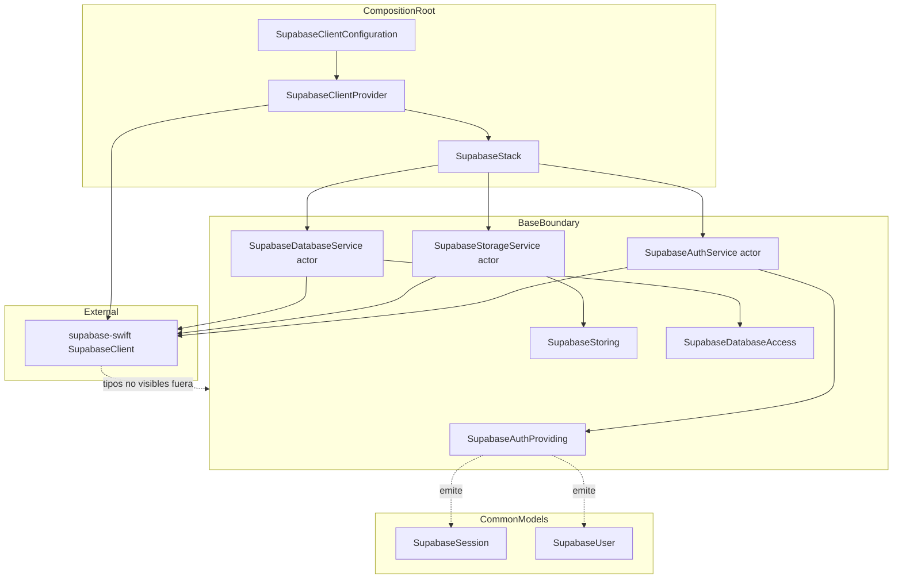
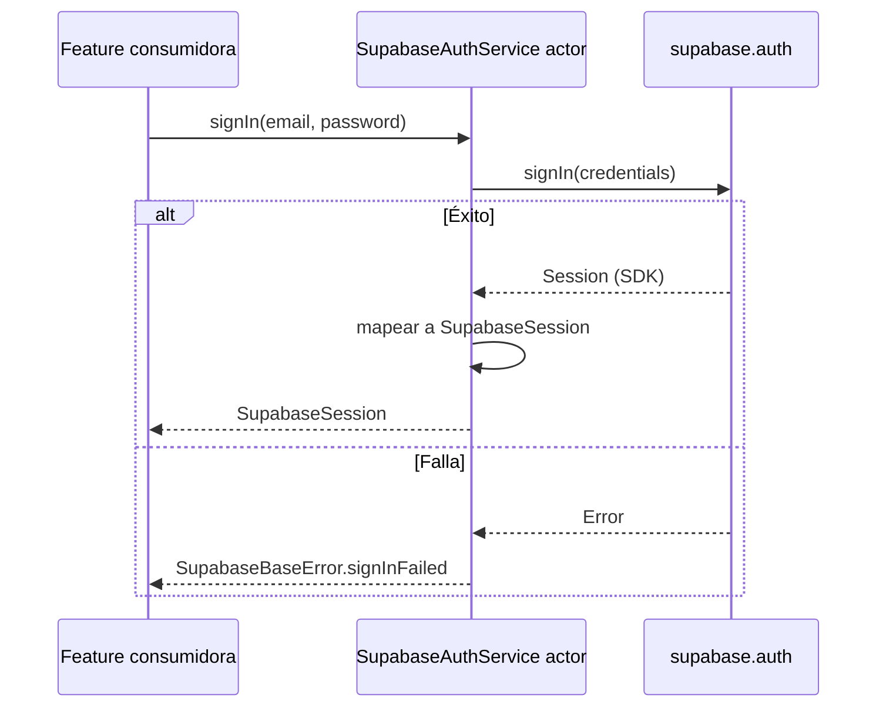

# Design Document: supabase-foundation

---
**Purpose**: Proporcionar suficiente detalle para una implementación consistente y sin deriva de interpretación entre implementadores de la capa base de Supabase.
**Enfoque**: Secciones esenciales que informan decisiones de implementación; diagramas y tablas sobre prosa extensa.
---

## Overview

Esta feature entrega la capa de datos compartida que el producto necesita para conectar las features `spot-discovery` y `account-personal` con Supabase (Auth, Postgres+PostGIS y Storage) sin duplicar cliente ni credenciales. Hoy las features existentes (`fish-species-identification`, `catch-log`) persisten en local con seams propios, no existe cliente de red compartido ni auth, y las credenciales viven sueltas en xcconfig sin infraestructura configurada. La capa base aporta un único cliente de Supabase construido en el composition root y expuesto tras tres protocolos segregados (`SupabaseAuthProviding`, `SupabaseStoring`, `SupabaseDatabaseAccess`), con auth funcional (registro, inicio de sesión, cierre de sesión, consulta/restauración de sesión), storage base (subir/descargar objetos) y un seam de base de datos agnóstico al esquema, además de modelos comunes `Codable`/`Sendable` y configuración centralizada por xcconfig.

**Users**: El equipo de desarrollo y las specs consumidoras `spot-discovery` y `account-personal`; indirectamente, los pescadores que usarán la cuenta y el mapa.

**Impact**: Introduce la primera dependencia outbound compartida (Supabase Swift SDK) y el primer seam de red único de la arquitectura; no modifica los seams existentes de `catch-log`/`fish-species-identification`.

### Goals
- Una única instancia del cliente de Supabase construida en el composition root y expuesta tras los protocolos del brief.
- Auth funcional y testeable (signUp/signIn/signOut/session/estado), storage base y seam de base de datos.
- Configuración centralizada (URL del proyecto y anon key) desde xcconfig gitignored, con degradación elegante sin infra configurada.
- Modelos comunes `Codable`/`Sendable` de sesión y usuario que no filtran tipos del SDK fuera del boundary base.
- Fake de los protocolos en el test target para que los tests de las features aguas abajo no contacten la red.

### Non-Goals
- Esquema de base de datos concreto (DDL SQL, PostGIS, tablas de spots/capturas) — lo definen las specs consumidoras.
- Pantallas o flujo de login/perfil (spec `account-personal`).
- Descubrimiento de spots o mapa (spec `spot-discovery`).
- Sincronización del registro de capturas ni migración de datos.
- Cambio de los seams existentes (`CatchSaving`, `CatchRepository`, `FishIdentifying`).

## Boundary Commitments

### This Spec Owns
- El `SupabaseClient` compartido (URL + anon key desde configuración) y su construcción (`SupabaseClientProvider`).
- Los protocolos `SupabaseAuthProviding`, `SupabaseStoring` y `SupabaseDatabaseAccess` y sus implementaciones concretas (`SupabaseAuthService`, `SupabaseStorageService`, `SupabaseDatabaseService`).
- La lectura de configuración `SupabaseClientConfiguration` (xcconfig → Info.plist → Bundle) y el manejo de ausencia/validez.
- Los modelos comunes `SupabaseSession` y `SupabaseUser` (`Codable`/`Sendable`) y el mapeo desde los tipos del SDK dentro del boundary.
- El estado de sesión notificado a la app (`SupabaseAuthEvent`) y la restauración de sesión al arrancar.
- El `SupabaseBaseFake` del test target y los tests de la propia capa.

### Out of Boundary
- DDL/Schema y consultas tipadas concretas de spots/capturas (specs consumidoras).
- UI de login/registro/perfil, mapa, favoritos, sync (specs aguas abajo).
- Cambios en los seams existentes de `catch-log`/`fish-species-identification`.
- Migración de datos existentes hacia Supabase.

### Allowed Dependencies
- Supabase Swift SDK v2 (SPM `supabase-swift`, producto `Supabase`) — única librería nueva (tech.md).
- Frameworks del sistema: Foundation, os (Logger).
- Patrones existentes de la app: composition root (`AppComposition`), lectura de credenciales por Bundle, stubs HTTP (`MockURLProtocol`/`HTTPStub`) en el test target.
- No dependencias de ninguna feature; la capa base no conoce Features ni Core de la app.

### Revalidation Triggers
- Cambio de contrato en los seams `SupabaseAuthProviding`/`SupabaseStoring`/`SupabaseDatabaseAccess` (firmas, tipos emitidos).
- Cambio en los tipos comunes `SupabaseSession`/`SupabaseUser` (campos, tipado).
- Cambio en la dirección de dependencias (si una feature pasa a conocer la implementación del SDK).
- Ampliación del seam de base de datos para combinar filtros u operadores PostgREST avanzados exigidos por un consumidor.
- Cambio en las claves de configuración (nombres de xcconfig/Info.plist) o en la degradación esperada sin infra.

## Architecture

### Architecture Pattern & Boundary Map

Patrón existente de la app (structure.md): MVVM por feature, Services detrás de protocolos, modelos `Codable` en `/Models`, configuración por xcconfig, composition root único. La capa base encaja como Services compartidos (`App/Services/Supabase/`) más modelos comunes (`App/Models/Supabase/`). Dirección de dependencias: Features → Services/Supabase → SDK; los protocolos son la frontera; el SDK solo se toca dentro de los servicios.



Los protocolos son la única vía por la que las features consumen la capa base. El `SupabaseStack` es un struct de valor que agrupa los tres seams; el composition root lo construye con `SupabaseClientProvider` y lo conserva como `SupabaseStack?` (opcional: sin configuración no hay stack).

**Architecture Integration**:
- **Selected pattern**: Provedores de red tras protocolos segregados, con cliente único construido en el composition root (extiende el patrón de Services existente).
- **Domain/feature boundaries**: Los tres seams son agnósticos a cualquier feature; los modelos de sesión/usuario no se mezclan con los modelos de dominio de capturas/especies.
- **Existing patterns preserved**: reconte de configuración por xcconfig/Info.plist, actores para concurrencia (nuevo pero alineado con Swift 6), stubs HTTP para tests.
- **New components rationale**: `SupabaseClientProvider` centraliza la construcción del único cliente; los actores servicio encapsulan los namespaces del SDK; la configuración failable evita romper el arranque sin infra.

### Technology Stack

| Layer | Choice / Version | Role in Feature | Notes |
|-------|------------------|-----------------|-------|
| Backend / Services | supabase-swift v2.x (SPM) | Cliente de auth, storage y PostgREST | Producto `Supabase`; la única librería nueva (tech.md) |
| Auth | Supabase Auth | Registro, login, logout, sesión | Namespace `supabase.auth` |
| Storage | Supabase Storage | Subir/descargar objetos en buckets | Namespace `supabase.storage` |
| Database | PostgREST over Postgres + PostGIS | Seam de lectura/escritura agnóstico al esquema | Namespace `supabase.postgrest`/`rpc` |
| Configuration | xcconfig → Info.plist | URL del proyecto y anon key | Patrón existente (FishialCredentials) |
| Runtime | iOS 17+, Swift 6, XCTest | Restricciones del proyecto | Actores para Sendable |

## File Structure Plan

### New Files
```
App/
├── Models/Supabase/
│   ├── SupabaseUser.swift            # Modelo común del usuario: id, email, createdAt (Codable/Sendable)
│   └── SupabaseSession.swift         # Modelo común de sesión: accessToken, refreshToken, expiresAt, user
├── Services/Supabase/
│   ├── SupabaseConfiguration.swift   # SupabaseClientConfiguration: lectura de URL + anon key desde Bundle (failable)
│   ├── SupabaseClientProvider.swift  # SupabaseClientProvider + SupabaseStack + SupabaseBaseError
│   ├── SupabaseAuthProviding.swift   # Protocolo de auth + SupabaseAuthEvent
│   ├── SupabaseAuthService.swift     # Actor: implementa el protocolo sobre supabase.auth
│   ├── SupabaseStoring.swift         # Protocolo de storage + SupabaseUploadOptions
│   ├── SupabaseStorageService.swift  # Actor: implementa el protocolo sobre supabase.storage
│   ├── SupabaseDatabaseAccess.swift  # Protocolo de BD + SupabaseFilter/SupabaseOperator/SupabaseJSONValue/SupabaseRPCArguments
│   └── SupabaseDatabaseService.swift # Actor: implementa el protocolo sobre supabase.postgrest/rpc
```
Test target:
```
App/BetterFishingTests/
├── SupabaseBaseFake.swift            # Fake de los tres protocolos (éxito/fallo programables) para features aguas abajo
├── SupabaseConfigurationTests.swift  # Lectura de config válida/inválida/ausente
├── SupabaseModelsTests.swift         # Round-trip Codable de sesión y usuario
├── SupabaseAuthServiceTests.swift    # Auth con stubs HTTP del SDK
├── SupabaseStorageServiceTests.swift # Storage con stubs HTTP del SDK
├── SupabaseDatabaseServiceTests.swift# select/rpc con stubs HTTP del SDK
├── SupabaseClientProviderTests.swift # Stack válido/inválido y errores de configuración
└── SupabaseCompositionTests.swift    # Composition root: stack nil sin config; stack construido con config
```

### Modified Files
```
App/
├── AppCompositionSupport.swift       # Construir SupabaseStack en makeRootServices; añadir `supabase: SupabaseStack?` a AppRootServices; log del motivo si no hay stack
├── Resources/Info.plist              # Añadir claves SupabaseProjectURL y SupabaseAnonKey ($() desde xcconfig)
├── Resources/Debug.xcconfig.example  # Añadir SUPABASE_PROJECT_URL y SUPABASE_ANON_KEY (vacías, plantilla)
└── Resources/Release.xcconfig.example# Añadir SUPABASE_PROJECT_URL y SUPABASE_ANON_KEY (vacías, plantilla)

BetterFishing.xcodeproj/project.pbxproj  # Añadir dependencia SPM supabase-swift (producto Supabase) y los ficheros nuevos al target
```
> `Debug.xcconfig`/`Release.xcconfig` reales no se versionan (patrón existente); las plantillas `.example` sí se versionan y deben quedar con los valores vacíos.

## System Flows

### Inicio de sesión (auth de la capa base)


### Arranque con configuración y restauración de sesión
```mermaid
flowchart TD
    A[composition root makeRootServices] --> B{config válida?}
    B -- no --> C[log "configuración de Supabase ausente" + stack nil]
    B -- sí --> D[SupabaseClientProvider.makeStack]
    D --> E[SupabaseClient con URL + anon key]
    E --> F[Actores Auth/Storage/Database envuelven el cliente]
    F --> G[Restauración de sesión automática del SDK al construirse]
    G --> H[stack inyectado en AppRootServices]
```

## Requirements Traceability

| Requirement | Summary | Components | Interfaces | Flows |
|-------------|---------|------------|------------|-------|
| 1.1 | Instancia única de cliente tras protocolos | SupabaseClientProvider, SupabaseStack, SupabaseAuthService/Storage/DatabaseService | Service | Arranque |
| 1.2 | Entregar solo protocolos a features | SupabaseStack | Service | — |
| 1.3 | Único punto de acceso a Supabase | Todos los servicios base | Service | — |
| 1.4 | Sin acoplamiento a features | Límite de dirección de dependencias | — | — |
| 2.1 | URL y anon key desde xcconfig | SupabaseClientConfiguration, SupabaseClientProvider | Service | Arranque |
| 2.2 | No iniciar cliente y log si config ausente/inválida | SupabaseClientConfiguration, AppComposition | Service | Arranque |
| 2.3 | Sin credenciales en claro en el código | SupabaseClientConfiguration (lectura desde Bundle) | — | — |
| 2.4 | Ficheros de config no versionados | xcconfig .example, .gitignore | — | — |
| 3.1 | Registro con email/contraseña devuelve sesión | SupabaseAuthService | Service | Auth |
| 3.2 | Inicio de sesión establece sesión consultable | SupabaseAuthService | Service | Auth |
| 3.3 | Cierre de sesión termina la sesión local | SupabaseAuthService | Service | Auth |
| 3.4 | Consulta de usuario y sesión actuales | SupabaseAuthService | Service | Auth |
| 3.5 | Restauración de sesión guardada al arrancar | SupabaseAuthService (restauro del SDK) | Service | Arranque |
| 3.6 | Errores tipados que distinguen motivo | SupabaseBaseError | Service | Auth |
| 3.7 | Notificación de cambios de sesión | SupabaseAuthEvent, SupabaseAuthService | Event | Auth |
| 4.1 | Subir objeto y devolver ruta | SupabaseStorageService | Service | Storage |
| 4.2 | Descargar objeto por ruta/bucket | SupabaseStorageService | Service | Storage |
| 4.3 | Errores tipados de storage | SupabaseBaseError | Service | Storage |
| 4.4 | Buckets/rutas arbitrarias | SupabaseStoring (bucket como parámetro) | Service | Storage |
| 5.1 | Seam de BD para leer/escribir | SupabaseDatabaseService | Service | Database |
| 5.2 | Base no define el esquema | SupabaseDatabaseAccess (agnóstico) | Service | — |
| 5.3 | Seam agnóstico al contenido | SupabaseDatabaseAccess | Service | — |
| 6.1 | Modelos comunes Codable/Sendable | SupabaseSession, SupabaseUser | State | — |
| 6.2 | No filtrar tipos del SDK | Mapeo interno en AuthService | Service | — |
| 6.3 | Solo seams base hacia consumidoras | SupabaseStack | Service | — |
| 7.1 | Fake con éxito/fallo programables | SupabaseBaseFake | Service | — |
| 7.2 | Auth sin red con fake | SupabaseBaseFake empleado por tests | Service | — |
| 7.3 | Storage sin red con fake | SupabaseBaseFake empleado por tests | Service | — |
| 7.4 | Protocolos sustituibles sin tocar la app | Seams por protocolo | Service | — |

## Components and Interfaces

| Component | Domain/Layer | Intent | Req Coverage | Key Dependencies (P0/P1) | Contracts |
|-----------|--------------|--------|--------------|--------------------------|-----------|
| SupabaseClientConfiguration | Service | Lectura de URL + anon key desde Bundle | 2.1–2.4 | Bundle (P0) | State |
| SupabaseClientProvider | Service | Construcción del único SupabaseClient y el SupabaseStack | 1.1, 1.3, 2.1 | SupabaseClientConfiguration (P0), SDK (P0) | Service |
| SupabaseAuthService | Service | Actor que implementa SupabaseAuthProviding sobre supabase.auth | 3.1–3.7, 6.2 | SDK auth (P0) | Service, Event |
| SupabaseStorageService | Service | Actor que implementa SupabaseStoring sobre supabase.storage | 4.1–4.4 | SDK storage (P0) | Service |
| SupabaseDatabaseService | Service | Actor que implementa SupabaseDatabaseAccess sobre postgrest/rpc | 5.1–5.3 | SDK postgrest (P0) | Service |
| SupabaseSession | Models | Modelo común de sesión | 6.1 | SupabaseUser | State |
| SupabaseUser | Models | Modelo común de usuario | 6.1 | — | State |
| SupabaseStack | Service | Agrupación de los tres seams; valor opcional en el composition root | 1.1–1.4, 6.3 | AuthService/StorageService/DatabaseService | State |
| SupabaseBaseError | Service | Errores tipados de configuración/auth/storage/db | 2.2, 3.6, 4.3 | — | — |
| AppComposition (modificado) | Composition Root | Construir/inyectar el stack | 1.1, 2.2 | Todos los anteriores | Service |

### Services Layer

#### SupabaseClientConfiguration
| Field | Detail |
|-------|--------|
| Intent | Leer URL del proyecto y anon key de Supabase desde la configuración de build (Info.plist vía xcconfig) |
| Requirements | 2.1–2.4 |

**Contracts**: State [x]

##### State / Structure
```swift
struct SupabaseClientConfiguration: Equatable, Sendable {
    let projectURL: URL
    let anonKey: String
    init(projectURL: URL, anonKey: String)
    init?(bundle: Bundle = .main)
}
```
- `init?(bundle:)` lee `SupabaseProjectURL` y `SupabaseAnonKey` de `bundle.object(forInfoDictionaryKey:)`.
- Devuelve `nil` si alguna clave falta, está vacía o la URL no es parseable.
- Postcondiciones: nunca contiene credenciales en claro literales; los valores vacíos se traducen a `nil` (Req 2.2, 2.3).

#### SupabaseClientProvider
| Field | Detail |
|-------|--------|
| Intent | Construir la única instancia del cliente de Supabase y envolverla en los tres servicios del stack |
| Requirements | 1.1, 1.3, 2.1 |

**Contracts**: Service [x]

##### Service Interface
```swift
struct SupabaseClientProvider: Sendable {
    let configuration: SupabaseClientConfiguration
    func makeStack(options: SupabaseClientOptions? = nil) throws -> SupabaseStack
    func makeClient(options: SupabaseClientOptions? = nil) throws -> SupabaseClient
}
```
- Precondiciones: `configuration` válida (ya validada en la lectura).
- Postcondiciones: `makeStack` crea UNA instancia de `SupabaseClient` y la reutiliza en los tres actores; el `SupabaseClient` nunca se expone fuera del provider/stack.
- Errores: `SupabaseBaseError.invalidProjectURL` si la URL no puede formar un cliente.
- Nota: `options` permite inyectar una `URLSession` personalizada en los tests (stubs), con el patrón `MockURLProtocol` existente.

#### SupabaseAuthProviding (protocolo) y SupabaseAuthService (actor)
| Field | Detail |
|-------|--------|
| Intent | Auth funcional (registro, login, logout, sesión, estado) sin exponer tipos del SDK |
| Requirements | 1.1–1.4, 3.1–3.7, 6.2, 6.3, 7.1–7.4 |

**Contracts**: Service [x] / Event [x]

##### Service Interface
```swift
protocol SupabaseAuthProviding: Sendable {
    func signUp(email: String, password: String) async throws -> SupabaseSession
    func signIn(email: String, password: String) async throws -> SupabaseSession
    func signOut() async throws
    func currentUser() async -> SupabaseUser?
    func currentSession() async throws -> SupabaseSession?
    func stateChanges() -> AsyncStream<SupabaseAuthEvent>
}

enum SupabaseAuthEvent: Sendable {
    case signedIn(SupabaseSession)
    case sessionRestored(SupabaseSession)
    case signedOut
}
```
- `signUp`/`signIn`: llaman a `supabase.auth` y mapean el resultado a `SupabaseSession` interno; nunca devuelven tipos del SDK.
- `signOut`: termina la sesión local.
- `currentUser`/`currentSession`: consultan el estado del SDK y lo mapean.
- `stateChanges()`: proyección acotada de `supabase.auth.stateChanges` (mapea `initialSession`→`.sessionRestored`, `signedIn`→`.signedIn`, `signedOut`→`.signedOut`); elemento `Sendable`.
- Implementación como `actor` aislando el `SupabaseClient` compartido.
- Restauración de sesión (Req 3.5): la realiza el propio SDK con su almacenamiento por defecto al construir el cliente; mapear `initialSession` en `stateChanges` informa de la restauración.

#### SupabaseStoring (protocolo) y SupabaseStorageService (actor)
| Field | Detail |
|-------|--------|
| Intent | Storage base (subir/descargar) sobre buckets y rutas arbitrarias |
| Requirements | 4.1–4.4, 7.1–7.4 |

**Contracts**: Service [x]

##### Service Interface
```swift
protocol SupabaseStoring: Sendable {
    func upload(
        bucket: String,
        path: String,
        data: Data,
        options: SupabaseUploadOptions?
    ) async throws -> String
    func download(bucket: String, path: String) async throws -> Data
}

struct SupabaseUploadOptions: Equatable, Sendable {
    var contentType: String
    var upsert: Bool
    init(contentType: String = "application/octet-stream", upsert: Bool = false)
}
```
- `upload` devuelve la ruta del objeto almacenado (Req 4.1); se delega en `supabase.storage.from(bucket).upload(path:data:options:)`.
- `download` devuelve los `Data` (Req 4.2); se delega en `from(bucket).download(path:)`.
- No asume ningún bucket de ninguna feature (Req 4.4).
- Errores mapeados a `SupabaseBaseError.uploadFailed`/`.downloadFailed` (Req 4.3).

#### SupabaseDatabaseAccess (protocolo) y SupabaseDatabaseService (actor)
| Field | Detail |
|-------|--------|
| Intent | Seam genérico de base de datos (lectura con filtros y rpc) agnóstico al esquema |
| Requirements | 5.1–5.3, 7.1–7.4 |

**Contracts**: Service [x]

##### Service Interface
```swift
protocol SupabaseDatabaseAccess: Sendable {
    func select<T: Decodable & Sendable>(
        columns: String,
        from table: String,
        filters: [SupabaseFilter],
        limit: Int?
    ) async throws -> [T]
    func rpc<T: Decodable & Sendable>(
        _ function: String,
        arguments: SupabaseRPCArguments?
    ) async throws -> T
}

struct SupabaseFilter: Equatable, Sendable {
    let column: String
    let `operator`: SupabaseFilterOperator
    let value: String
}
enum SupabaseFilterOperator: String, Sendable {
    case eq, neq, gt, gte, lt, lte
}
struct SupabaseRPCArguments: Equatable, Sendable {
    var values: [String: SupabaseJSONValue]
    init(_ values: [String: SupabaseJSONValue])
}
enum SupabaseJSONValue: Equatable, Sendable {
    case string(String), double(Double), int(Int), bool(Bool), null
}
```
- `select` se implementa sobre `supabase.postgrest.from(table).select(columns)` aplicando cada filtro (`.eq/.neq/.gt/.gte/.lt/.lte`) y `limit`, decodificando a `[T]`.
- `rpc` se implementa sobre `supabase.rpc(function, params:)` con los argumentos codificados desde `SupabaseRPCArguments`.
- El esquema y las consultas tipadas de las features se construyen encima; la base no conoce tablas (Req 5.2, 5.3).
- Postcondiciones: sin tipos del SDK en el tipo de retorno; `SupabaseJSONValue` se codifica a JSON antes de llamar a `rpc`.

## Data Models

### Domain Model
Los modelos de la capa base son solo sesión y usuario. No se modelan capturas, spots ni especies (dominios de otras specs).

### Logical Data Model

```swift
struct SupabaseUser: Codable, Equatable, Identifiable, Sendable {
    let id: UUID
    let email: String?
    let createdAt: Date
}

struct SupabaseSession: Codable, Equatable, Sendable {
    let accessToken: String
    let refreshToken: String
    let expiresAt: Date
    let user: SupabaseUser
}
```
- `SupabaseUser`: identificador, email opcional (confirmaciones de email pendientes pueden dejar el email ausente) y fecha de creación.
- `SupabaseSession`: tokens de acceso y refresco, expiración y el usuario asociado; es el tipo emitido por auth a las features.
- Mapeo interno en `SupabaseAuthService` desde `Supabase.Session`/`Supabase.User` (id, email, createdAt, accessToken, refreshToken, expiresAt); el mapeo vive dentro del boundary base (Req 6.2).

### Data Contracts & Integration
- Los tokens de sesión viajan dentro de `SupabaseSession`; quien los consuma (downstream) los trata como opacos.
- `SupabaseJSONValue`/`SupabaseRPCArguments` son el contrato de argumentos para `rpc`; no se exponen `AnyJSON` ni el query builder del SDK.

## Error Handling

### Error Strategy
- **Fail fast**: configuración inválida → no se construye el cliente y se registra el motivo (log claro).
- **Graceful degradation**: sin configuración, la app arranca con el resto de servicios y `supabase == nil`.
- **User context**: errores tipados por dominio (config, signUp, signIn, signOut, upload, download, query) con descripción localizable; las features aguas abajo deciden cómo mostrarlos.

### Error Categories and Responses
**Configuration**:
- Config ausente/vacía → `SupabaseBaseError.configurationMissing` (log en composition root; stack nil) (Req 2.2).
- URL inválida → `SupabaseBaseError.invalidProjectURL` (log; stack nil) (Req 2.2).

**Auth (Req 3.6)**:
- Credenciales inválidas → `.signInFailed` con descripción del SDK.
- Error de red → `.signInFailed`/`.signUpFailed` con descripción.
- Sesión no disponible al consultar → `.sessionUnavailable`.

**Storage (Req 4.3)**:
- Objeto inexistente o permiso denegado → `.downloadFailed`/`.uploadFailed` con descripción del SDK.

**Database (Req 5.x)**:
- Error de consulta → `.queryFailed`; error de rpc → `.rpcFailed`.

### Monitoring
- Log con `os.Logger` (subsistema BetterFishing, categoría `Supabase`) de: construcción del stack (éxito/motivo de ausencia), errores de auth/storage/db, y cambios de sesión relevantes (signedIn/signedOut) sin volcar tokens.

## Testing Strategy

### Unit Tests
- `SupabaseConfigurationTests`: config válida (URL + anon key) desde un bundle de test; config nil con clave ausente, clave vacía y URL malformada (Req 2.x).
- `SupabaseModelsTests`: round-trip Codable de `SupabaseSession` y `SupabaseUser` completos (Req 6.1).
- `SupabaseClientProviderTests`: `makeStack` con config válida produce stack no nil con los tres seams; URL inválida lanza `invalidProjectURL` (Req 1.1, 2.1).
- `SupabaseBaseFake`: verificar que el fake permite programar éxito/fallo en los tres protocolos (Req 7.x).
- `SupabaseDatabaseServiceTests` (parte unitaria): codificación de `SupabaseRPCArguments` a JSON y de `SupabaseFilter` a operadores PostgREST.

### Integration Tests (stubs HTTP del SDK, sin red real)
- `SupabaseAuthServiceTests` con `MockURLProtocol`/`HTTPStub`: signUp y signIn parsean la sesión del endpoint y devuelven `SupabaseSession`; signOut llama al endpoint; credenciales inválidas (401) → `signInFailed`; restauración mapea el evento inicial a `.sessionRestored` (Req 3.x, 6.2).
- `SupabaseStorageServiceTests` con stubs: upload devuelve la ruta; download devuelve `Data`; 404 de descarga → `downloadFailed` (Req 4.x).
- `SupabaseDatabaseServiceTests` con stubs: select decodifica `[T]` y aplica filtro/límite; rpc devuelve `T`; errores 4xx/5xx → `queryFailed`/`rpcFailed` (Req 5.x).
- `SupabaseCompositionTests`: con config vacía `makeRootServices` construye los servicios existentes y `supabase == nil` (Req 2.2, 1.1); con config inyectada construye el stack y los tres seams son no nil (Req 1.1).

### E2E/UI Tests
- No aplica: la capa base no tiene UI. Los flujos de UI de auth/storage son de `account-personal`/`spot-discovery` y consumirán los protocolos con `SupabaseBaseFake` (Req 7.x).

## Optional Sections

### Security Considerations
- La anon key y la URL se leen de build settings versionadas solo como plantilla vacía; nunca en el código fuente ni en el repositorio (Req 2.x).
- Los tokens de sesión solo viajan dentro de `SupabaseSession` y no se registran en logs.
- El cliente usa la anon key (clave publicable); operaciones sensibles se protegen con RLS en el backend (decisión de las specs consumidoras y del provisioning de Supabase, fuera de esta spec).
- El único control de acceso del cliente es el estado de sesión encapsulado en `SupabaseAuthService`.

### Performance & Scalability
- Un único `SupabaseClient` compartido evita conexiones/estados duplicados (Req 1.3).
- `select` soporta `limit` para acotar lecturas grandes; sin paginación obligatoria (los consumidores deciden).
- Los actores serializan el acceso al cliente compartido; las llamadas son async y el SDK multiplexa por URLSession, sin bloqueos relevantes.

### Migration Strategy
- No hay migración de datos en esta spec. Al requerirse (sync del registro en `account-personal`), las specs consumidoras la definen sin cambiar los seams de esta capa.