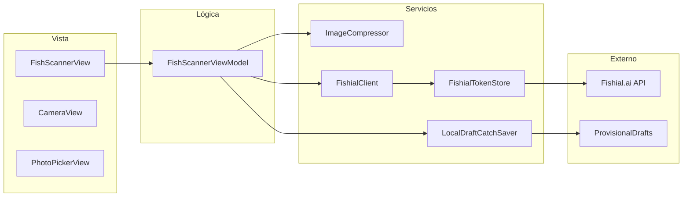

# BetterFishing


> Una app de pesca pensada para que el pescador encuentre buenos sitios donde pescar
> e identifique al instante las especies que captura con la cámara del móvil.

BetterFishing adapta la promesa de **"identificar qué has pescado"** a un escáner de
pez por IA: fotografías desde la cámara o el carrete, identificación por
reconocimiento visual y guardado de la captura con la especie pre-rellena.

---

## Funcionalidades

La primera capability implementada y funcionando de extremo a extremo es la
**identificación de especies por foto**:

- **Captura o selección de imagen** desde la cámara del dispositivo o desde la galería.
- **Identificación por IA** contra la API de [Fishial.ai](https://fishial.ai)
  (endpoints `/v2/auth` y `/v2/recognize`) con gestión automática del token JWT.
- **Avisos de fiabilidad**: se distingue una identificación fiable de una de baja
  confianza, y se avisa cuando no hay ninguna coincidencia.
- **Reintento**: ante un resultado no fiable o un error, se puede volver al selector
  de fuente y probar con otra foto.
- **Guardado provisional de la captura** con la especie pre-rellena (nombre común +
  científico), persistida localmente en el dispositivo.
- **Estados de carga y cancelación** durante todo el proceso.

El resto de capabilities de la visión de producto (mapa de spots, registro de
capturas, información por especie, cuenta de usuario) está en planificación y se
construirá sobre esta misma arquitectura.

---

## Arquitectura

La app es **iOS nativa (SwiftUI)** con una organización **feature-first**: el código
se agrupa por funcionalidad y cada feature sigue el patrón **MVVM**. Los servicios
externos se encapsulan detrás de **protocolos seam** (`FishIdentifying`, `CatchSaving`)
para poder inyectar dobles en los tests, y la dirección de dependencias es
unidireccional: **Features → Services → Core**.



### Flujo de identificación

```
Foto (cámara | galería)
      │
      ▼
setImage(data) ──► ImageCompressor (resize/compress) ──► recognize(imageData)
                                                              │
                              ┌───────────────────────────────┼───────────────────┐
                              ▼                               ▼                   ▼
                      identified(.reliable)          identified(.low)          noMatch
                              │                               │                   │
                Guardado con especie pre-rellena   Aviso de fiabilidad      Aviso + reintento
```

### Stack principal

| Capa | Tecnología |
|------|-----------|
| Lenguaje | Swift 5.9 |
| UI | SwiftUI |
| Runtime | iOS 17+ |
| Red | URLSession (base URL centralizada en `AppCompositionSupport`) |
| Identificación | Fishial.ai Recognition API |
| Tests | XCTest (unit + UI) |

---

## Estructura del proyecto

```
BetterFishing/
├── App/
│   ├── BetterFishingApp.swift                # Punto de entrada (@main) + RootView
│   ├── AppCompositionSupport.swift           # Composition root + seams de UI test
│   ├── Features/
│   │   └── FishScanner/                      # Capability: identificación de especies
│   │       ├── FishScannerView.swift         #   Vistas y estados del escáner
│   │       ├── FishScannerViewModel.swift    #   Máquina de estados + orquestación
│   │       ├── CameraManager.swift           #   Sesión AVFoundation
│   │       ├── CameraView.swift              #   Preview de cámara
│   │       ├── PhotoPickerView.swift         #   Selector de galería (PhotosPicker)
│   │       ├── FishScannerPreviewSupport.swift # Dobles de vista para Xcode previews
│   │       └── CameraManagerUITestDouble.swift  # Doble DEBUG de cámara para UI tests
│   ├── Services/
│   │   └── FishID/
│   │       ├── FishIdentifying.swift         #   Protocolo seam de identificación
│   │       ├── CatchSaving.swift             #   Protocolo seam de guardado
│   │       ├── FishialClient.swift           #   Cliente HTTP Fishial.ai
│   │       ├── FishialTokenStore.swift       #   Caché/renovación del JWT
│   │       └── LocalDraftCatchSaver.swift    #   Guardado provisional en disco
│   ├── Core/
│   │   └── Image/
│   │       └── ImageCompressor.swift         # Redimensionado/compresión JPEG
│   ├── Models/
│   │   ├── Species.swift                     # Modelo de dominio canónico
│   │   ├── CatchDraft.swift                  # Borrador provisional de captura
│   │   └── Fishial/                          # DTOs y resultados de identificación
│   ├── Resources/
│   │   ├── Info.plist
│   │   ├── Debug.xcconfig.example            # Plantilla de configuración
│   │   ├── Release.xcconfig.example
│   │   └── Assets.xcassets
│   ├── BetterFishingTests/                   # 97 tests unitarios (XCTest)
│   └── BetterFishingUITests/                 # 6 tests E2E (XCTest UI)
├── BetterFishing.xcodeproj/
└── .kiro/                                    # Spec-driven development (Kiro)
```

---

## Puesta en marcha

### Requisitos

- **Xcode** (última versión estable; se usa Xcode 27)
- Un proyecto/claves de la **API de Fishial.ai** (`client_id` + `client_secret`)

> `xcode-select` del sistema puede apuntar a las CommandLineTools. Si `xcodebuild`
> no encuentra Xcode, antepón `DEVELOPER_DIR=/Applications/Xcode.app/Contents/Developer`:

```bash
export DEVELOPER_DIR=/Applications/Xcode.app/Contents/Developer
```

### Configuración de credenciales

Las credenciales viven en `.xcconfig` ignorados por git. Un checkout limpio necesita
partir de las plantillas `.example` y rellenarlas:

```bash
cp App/Resources/Debug.xcconfig.example   App/Resources/Debug.xcconfig
cp App/Resources/Release.xcconfig.example App/Resources/Release.xcconfig
# Editar y rellenar:
#   FISHIAL_CLIENT_ID = <tu-client-id>
#   FISHIAL_CLIENT_SECRET = <tu-client-secret>
```

La app las lee del `Info.plist` (claves `FishialClientID`/`FishialClientSecret`,
inyectadas desde el `.xcconfig`). **Nunca** se hardcodean en código ni se guardan en
`UserDefaults`.

### Build y tests

```bash
# Build de Debug
xcodebuild -scheme BetterFishing \
  -destination 'platform=iOS Simulator,name=iPhone 17' build

# Suite completa de tests (97 unitarios + 6 E2E)
xcodebuild -scheme BetterFishing \
  -destination 'platform=iOS Simulator,name=iPhone 17' test

# Solo UI tests (más rápido para E2E)
xcodebuild test-without-building -scheme BetterFishing \
  -destination 'platform=iOS Simulator,name=iPhone 17' \
  -only-testing:BetterFishingUITests

# Release (también válido como comprobación de absentismo de dobles)
xcodebuild -scheme BetterFishing -configuration Release \
  -destination 'generic/platform=iOS Simulator' build
```

### Deploy en dispositivo

Por defecto el proyecto desactiva la firma de código
(`CODE_SIGNING_ALLOWED=NO`) para que `xcodebuild` funcione en un checkout limpio sin
equipo de desarrollo. Para desplegar en un dispositivo físico, selecciona tu `Team`
en el target y reactiva la firma.

---

## Estrategia de testing

Los E2E no dependen de red real ni de la hoja del sistema de fotos: el composition
root inyecta **dobles DEBUG activados por launch-arguments** al arrancar la app de
test. Así cada flujo crítico se ejercita de forma determinista:

```bash
xcrun simctl launch booted "com.betterfishing.BetterFishing" \
  --ui-test-double identifiedReliable
```

| Escenario | Comportamiento del doble | E2E que lo usa |
|-----------|--------------------------|----------------|
| `identifiedReliable` | Largemouth Bass, confianza fiable | Cámara → identificado |
| `identifiedLowConfidence` | Bluegill, confianza baja | Galería → aviso de fiabilidad |
| `noMatch` | Sin coincidencia | Aviso + reintento |
| `saveSucceeds` | Recibe foto → identificado → guardado OK | Guardado con éxito |
| `saveFails` | Cámara/galería → identificado → guardado falla la 1ª llamada | Fallo + reintento |

Los dobles viven bajo `#if DEBUG` y **no se compilan en Release**; la ruta de
producción inyecta siempre los servicios reales (`FishialClient`,
`LocalDraftCatchSaver`, `CameraManager`).

| Suite | Cobertura |
|-------|-----------|
| Unit (97) | Modelos y DTOs, `FishialClient` con `URLProtocol` mockeado, `FishialTokenStore`, `ImageCompressor`, `CameraManager`, máquina de estados, `LocalDraftCatchSaver` |
| UI E2E (6) | Smoke de arranque, cámara → identificado, galería → baja confianza, sin coincidencia → reintento, guardado con éxito y con fallo |

---

## Hoja de ruta

- **Hecho**: identificación de especies por foto (escáner + IA + guardado provisional).
- **En planificación**:
  - Mapa de spots de pesca con ubicación y valoración por zona (Supabase + MapKit + CoreLocation).
  - Registro completo de capturas (historial, edición, sincronización).
  - Información por especie (características, normativa y talla mínima).
  - Cuenta de usuario para spots favoritos y sincronización entre dispositivos.

---

## Desarrollo guiado por especificación

Este repositorio usa un flujo **spec-driven** (`/kiro/…` en `.kiro/`): cada capability
se formaliza en requisitos → diseño → tareas → implementación TDD → revisión
adversarial → validación de integración. La spec activa de la identificación de
especies vive en `.kiro/specs/fish-species-identification/`.